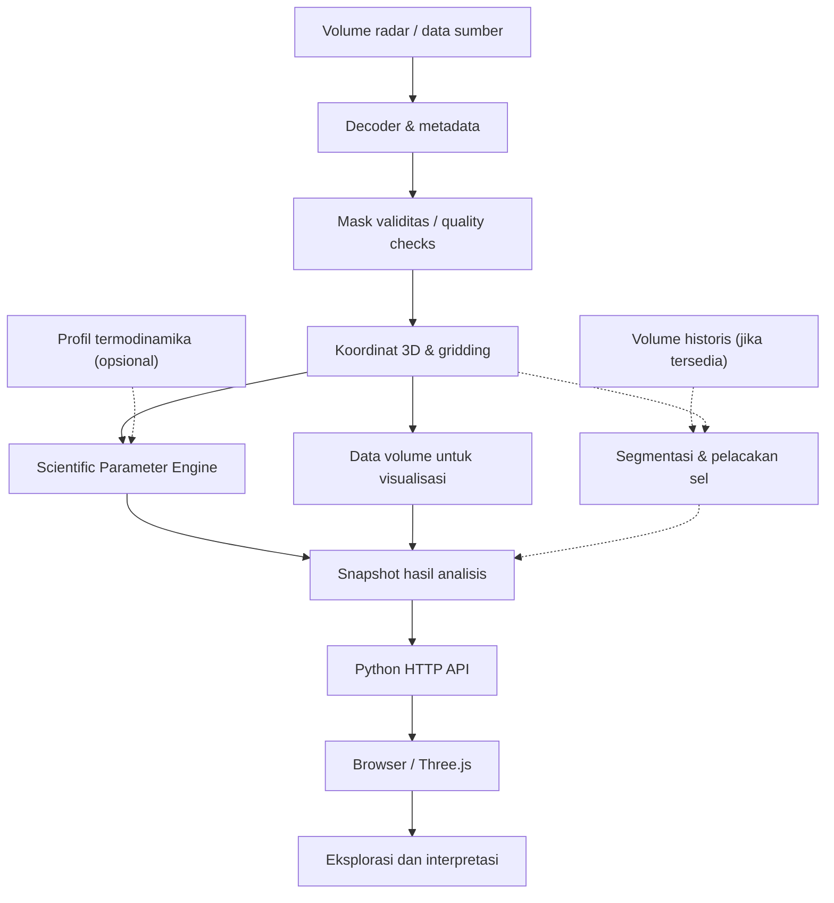

# Implementation Plan — SATRIA-3D OMC Portfolio

> **Target halaman:** `/project/satria-3d-omc` (**placeholder — verifikasi route aktual dalam repository**). Ini adalah brief untuk Claude Code / coding agent mengimplementasikan **section case study portofolio** SATRIA-3D OMC, **bukan instruksi membangun ulang sistem radar** atau artikel akademik.

**Proyek:** **SATRIA-3D OMC**, platform analisis radar cuaca Doppler volumetrik tiga dimensi dan visualisasi interaktif untuk mendukung karakterisasi awan konvektif dalam konteks Operasi Modifikasi Cuaca.

**Landasan konten:** naskah rancangan ilmiah-teknis SATRIA-3D OMC yang dibahas penulis, terutama pemrosesan volume radar, rekonstruksi 3D, parameter meteorologi, pelacakan sel konvektif, Python HTTP backend, dan antarmuka Three.js.

**Aturan kebenaran:** bedakan dengan jelas **`Verified in code`**, **`Described in design`**, dan **`Planned / requires validation`**. Naskah monograf bukan bukti bahwa semua algoritma atau target performa sudah terimplementasi. Bila tidak ada repository SATRIA, jadikan representasi **konseptual** dan jangan berpura-pura menunjukkan data live.

## Tujuan section: How It Works

Jelaskan **perjalanan satu volume radar menjadi analisis awan 3D yang dapat dieksplorasi**, bukan sekadar daftar fitur. Buat **vertical scroll-driven narrative** dengan satu ilustrasi data-flow yang berubah sesuai chapter, mengikuti bahasa visual halaman portofolio existing. Hindari meniru diagram ilmiah secara kaku; animasi harus mendukung pemahaman proses, bukan dekorasi.

**Narasi inti:** *From radar sweeps to an explorable three-dimensional view of convective clouds.*

## Alur konten yang disarankan

| Tahap | Judul UI | Narasi utama | Fokus visual | Status yang harus dicek |
|---|---|---|---|---|
| **01** | **Volume Radar Masuk** | Satu volume memuat beberapa *sweep*; tiap sweep terdiri atas *ray* dan *range gate*. Data berasal dari hasil pemindaian radar Doppler. | Ilustrasi volume → sweep → ray → gate, penanda satu file data | Format berkas, sumber radar, dan mekanisme ingest aktual |
| **02** | **Decode & Quality Check** | Pembaca format mengurai metadata dan nilai radar; data hilang/tidak valid ditandai sebelum digunakan dalam analisis. | Berkas biner → array + mask kualitas; contoh label `missing` | Apakah QC yang diklaim benar-benar diimplementasikan |
| **03** | **Georeferensi dan Gridding** | Sampel polar \((r,\phi,\theta)\) dipetakan menjadi koordinat ruang 3D; grid voxel memudahkan ekstraksi struktur vertikal. | Sinar radar berbentuk kipas → grid Kartesian, dengan area *no observation* transparan | Metode 4/3 Earth, interpolasi, resolusi grid, dan validitasnya |
| **04** | **Parameter Meteorologis** | Medan reflektivitas diproses menjadi keluaran seperti CMAX, Echo Top, Echo Base, VIL, dan parameter lain **sesuai implementasi**. | Transformasi volume → peta CMAX / kolom ETOP / integrasi VIL | Parameter yang benar-benar tersedia, satuan, ambang, metode |
| **05** | **Evolusi Sel Konvektif** | Jika beberapa volume tersedia, objek konvektif dapat diidentifikasi dan dihubungkan antarpemindaian untuk melihat tren serta pergerakan. | Volume T₀–T₅ → centroid + lintasan + grafik tren | Pelacakan *SCIT-inspired* vs SCIT lengkap; nowcast hanya jika terbukti |
| **06** | **Distribusi ke Browser** | Backend Python melayani data/metadata melalui HTTP; browser menerima snapshot lalu menyiapkan objek visual. | Python server ↔ HTTP API ↔ browser; respons berupa data terstruktur | Endpoint, skema payload, caching, refresh cadence aktual |
| **07** | **Eksplorasi Radar 3D** | Three.js/WebGL menampilkan data dalam ruang 3D. Pengguna dapat mengubah sudut pandang dan, bila tersedia, memeriksa voxel/profil vertikal atau riwayat sel. | Instanced voxel cloud, kontrol kamera, panel probe/SCIT | Status raycasting, VCS, recorder, dan fitur interaktif |

**Penting:** alur tersebut adalah **model narasi**. Pada implementasi nyata, produk 2D dan 3D mungkin dihitung dari representasi yang berbeda; tracking hanya berlaku saat deret waktu tersedia; data termodinamika (mis. freezing level) tidak berasal dari reflektivitas saja. Diagram tidak boleh menyiratkan bahwa semua tahapan wajib terjadi pada setiap permintaan pengguna.

## Desain dan interaksi

- **Desktop:** kolom kiri untuk step/timeline; kolom kanan untuk **sticky scientific visualization** yang memvisualisasikan _tahap yang sama_ dari satu volume. Sesuaikan tinggi dan offset sticky dengan navbar existing.
- **Mobile:** alur satu kolom dengan ilustrasi statis atau mini-snapshot per chapter; jangan memaksa canvas WebGL berat agar story bisa dibaca.
- Progres mengikuti **posisi scroll**, dapat maju dan mundur. Tidak ada autoplay yang berpura-pura memproses radar secara langsung.
- Transisi ilustrasi yang tepat: ikon volume berubah menjadi sapuan radar, sampel polar menjadi grid, grid menjadi volume berwarna, lalu ikon API → tampilan browser. **Jangan mengubah nilai data** demi animasi.
- Bedakan **data teramati**, **hasil interpolasi**, **hasil estimasi**, dan **data tidak tersedia** dengan legenda sederhana (mis. solid, titik, garis putus).
- Gunakan animasi transform/opacity singkat; untuk banyak objek pilih pre-rendered SVG, sprite, atau canvas ringan. Jangan menggunakan puluhan ribu mesh/voxel pada sekadar section portofolio.
- Jika repository memiliki screenshot/rekaman asli, gunakan setelah meneliti kecocokan versi aplikasi. Jika belum, ilustrasi SVG konseptual harus diberi penjelasan `Visualisasi konseptual`.
- Hindari grafik yang mengaku menunjukkan angka aktual (VIL, FPS, reflektivitas, koordinat target, nowcast) tanpa dataset atau hasil uji.
- Ikuti tipografi, design tokens, motion primitives, dan layout portofolio sebelumnya; hindari neon dan kartu glass yang berlebihan.
- Aksesibilitas: semantic `<ol>`, keyboard navigation bila step klik, status jelas tanpa warna semata, `prefers-reduced-motion`.

## Diagram logika internal (hanya untuk penulisan konten)

*Diagram konseptual untuk penulis/desainer. Urutan QC, interpolasi, komputasi parameter, mekanisme snapshot, dan hubungan modul harus dicocokkan terhadap kode aktual sebelum digambarkan sebagai fakta.*

## Contoh copy per chapter untuk section

- **01 — Data dimulai dari atmosfer.** Setiap volume radar mengumpulkan pengamatan pada berbagai elevasi, azimut, dan jarak.
- **02 — Bukan sekadar membaca file.** Metadata dan nilai pengamatan harus ditafsirkan dengan tepat; sampel bermasalah tidak disamakan dengan nol.
- **03 — Dari polar ke tiga dimensi.** Posisi hasil pemindaian dipetakan ke ruang spasial, dengan dukungan pengamatan yang tetap terlihat.
- **04 — Menghasilkan informasi meteorologis.** Parameter turunan menjelaskan intensitas, ketinggian, dan distribusi vertikal presipitasi.
- **05 — Sel awan terus berubah.** Deret waktu memungkinkan pemeriksaan kecenderungan dan perpindahan objek, jika pelacakan tersedia.
- **06 — Analisis dikirim sebagai data.** Lapisan HTTP memisahkan pemrosesan radar dari presentasi dalam browser.
- **07 — Struktur awan dapat dieksplorasi.** Visualisasi 3D membantu pembaca memahami posisi, bentuk, dan hubungan vertikal hasil radar.

## Fase implementasi

1. Audit repository portofolio: temukan **route aktual**, desain section project lain, komponen scroll-story, font, spacing, tema, motion, breakpoints, dan library yang sudah dipasang.
2. Audit repository/aplikasi SATRIA atau asetnya. Catat fitur terverifikasi, screenshot nyata, output radar, API, dan bagian naskah yang masih rancangan.
3. Susun `steps` sebagai data terstruktur (judul, copy, visual id, source status) agar teks dapat direvisi tanpa mengubah kode animasi.
4. Buat timeline semantik serta satu panel ilustrasi SVG/canvas ringan yang berpindah scene berdasarkan scroll/IntersectionObserver existing.
5. Tambahkan interaksi alternatif klik dan keyboard hanya bila sinkronisasi scroll berfungsi; hindari scroll hijacking.
6. Uji scroll pelan/cepat, reverse, resize, browser back, viewport 320–390 px, reduced motion, dan responsive screenshot.

## Acceptance khusus

- Pembaca dapat menjelaskan **radar volume → decoding → georeferensi → parameter → data API → visualisasi 3D** setelah melihat section.
- Pelacakan sel dan data termodinamika ditampilkan **kondisional**, tidak ditampilkan sebagai kewajiban setiap volume.
- Tidak ada klaim real-time, akurasi, efek peningkatan curah hujan, atau 60 FPS tanpa bukti.
- Distingsi antara data asli dan sampel hasil interpolasi terlihat.
- How It Works berfokus pada **alur transformasi data**, bukan daftar library atau arsitektur jaringan.

## Aturan wajib sebelum coding

1. Jangan mengasumsikan route `/project/satria-3d-omc` benar; temukan route halaman project yang benar dari repository. Jangan membuat duplikasi halaman.
2. Reuse komponen, utilitas animasi, design tokens, dan library yang sudah tersedia. Jangan menambah dependency hanya untuk dekorasi.
3. Jangan menganggap format `.vol` tertentu pasti milik radar EEC Balikpapan sebelum sumber file/decoder diperiksa.
4. Jangan menyatakan seluruh 14 komponen sebagai hasil pengukuran langsung radar; klasifikasikan produk, estimasi, data eksternal, dan fitur analisis.
5. Jangan menyebut pelacak *SCIT-inspired* sebagai implementasi SCIT asli tanpa bukti multithreshold/association yang sesuai.
6. Jangan menampilkan sample output atau screenshot rekayasa seolah-olah data pengamatan aktual; berikan label ilustrasi.
7. Jangan mengekspos path lokal sensitif, alamat jaringan internal, data mentah terbatas, atau konfigurasi rahasia.
8. Semua kontrol harus bekerja dengan mouse, touch, dan keyboard; reduced-motion harus bermakna.
9. Jangan memodifikasi komponen global, layout, atau section project lain di luar kebutuhan fitur ini.
10. Verifikasi status **implemented / design / planned** melalui bukti, bukan melalui narasi monograf.

## Definition of done

- Section berada pada halaman case study SATRIA-3D OMC yang benar dan konsisten dengan portofolio.
- Seven-step scroll narrative informatif pada desktop dan mobile, tanpa performa berat.
- Diagram/story menjelaskan transformasi data radar dengan benar, termasuk keterbatasan representasi.
- Tidak ada klaim performa atau keberhasilan OMC yang tidak terverifikasi.
- Lint, build, QA aksesibilitas, dan screenshot review dijalankan; ringkas file yang berubah dan hal yang belum dapat divalidasi.
