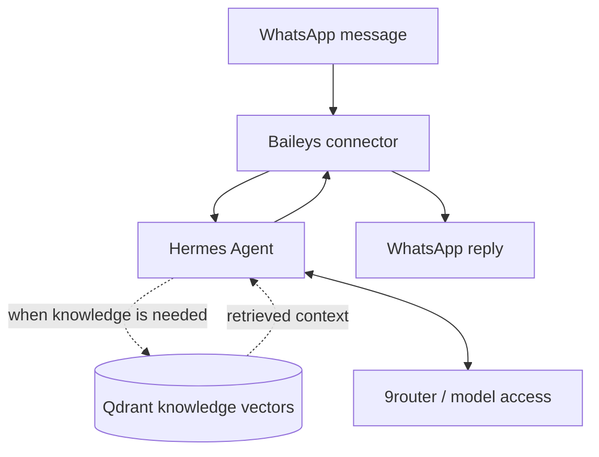

# Implementation Plan — WhatsApp AI Agent Portfolio

> Target halaman: `/project/whatsapp-ai-agent` (verifikasi route aktual di repository). Dokumen ini adalah brief untuk Claude Code mengimplementasikan **section halaman case study portofolio**, bukan deck presentasi atau instruksi membangun backend agent.

**Proyek:** WhatsApp AI Agent menggunakan Hermes Agent, Baileys, 9router, dan Qdrant sebagai vector knowledge database.

**Ketepatan fakta:** alur rinci antara Hermes, 9router, Qdrant, dan service penghubung harus diperiksa di repository agent jika tersedia. Pada situs portofolio, bedakan `Implemented`, `Architecture concept`, dan `Planned` berdasarkan bukti, bukan asumsi.

## Tujuan section: How It Works
Ceritakan bagaimana pesan WhatsApp menjadi respons yang memanfaatkan knowledge. Buat pengalaman **vertical scroll-driven narrative** dari atas ke bawah, mirip referensi How It Works di halaman portofolio lain, tetapi **bukan salinan visual 1:1**. Pertahankan gaya visual situs.

## Alur konten yang disarankan
Gunakan enam chapter narasi berikut, dengan label yang tidak berlebihan:

| Tahap | Judul untuk UI | Narasi utama | Visual fokus |
|---|---|---|---|
| 01 | Incoming Message | Pengguna mengirim pesan melalui WhatsApp. | Bubble pesan masuk, tidak meniru chat nyata |
| 02 | WhatsApp Connection | Baileys menghubungkan event pesan dengan layanan agent. | WhatsApp -> Baileys -> adapter |
| 03 | Agent Orchestration | Hermes Agent menerima konteks dan mengatur langkah respons. | Node Hermes aktif |
| 04 | Knowledge Retrieval | Untuk pertanyaan yang membutuhkan pengetahuan, sistem menelusuri koleksi knowledge di Qdrant bila integrasi retrieval terkonfirmasi. | Query -> Qdrant -> cuplikan sumber sintetis |
| 05 | Model Access | Permintaan inferensi melalui 9router, sesuai peran riilnya dalam implementasi yang ditemukan di repo. | Agent <-> 9router <-> model (label model generik) |
| 06 | Response Delivery | Respons agent dikirim kembali ke chat WhatsApp melalui koneksi Baileys. | Arrow kembali menuju bubble respons |

**Penting:** langkah 04/05 tidak mesti selalu dieksekusi dan urutannya bisa berulang. Jangan tampilkan pipeline satu arah deterministik yang salah secara teknis. Perlihatkan conditional retrieval dan loop inference sebagai *detail* kecil, atau ubah urutan sesuai kode aktual. Jangan mengklaim RAG, semantic search, agent tools, persistent conversation memory, atau sumber sitasi tampil dalam jawaban jika belum dibuktikan.

## Desain dan gerak
- Desktop: narasi step di satu sisi dan **sticky visual system map** di sisi lain; tata letak harus mengambil pola dari referensi existing. Jaga tinggi sticky agar tidak tertutup navbar.
- Mobile: satu kolom; visual mini per tahap atau panel inline, hindari memaksa area sticky besar.
- Timeline vertikal satu garis halus; progress mengikuti **scroll position**, bukan autoplay/time-based animation. Node aktif berpindah saat melewati viewport anchor.
- SVG path progress dapat memakai `stroke-dashoffset`/mask berbasis Motion jika sudah ada, atau IntersectionObserver + transform tanpa dependency baru. Hanya animasikan transform/opacity pada elemen banyak; batasi repaint.
- Setiap step punya keadaan `upcoming`, `active`, `completed`; animasi scroll ke atas harus reverse dengan benar.
- Crossfade atau translate pendek antar ilustrasi. Tidak ada partikel, glow neon, garis berdenyut tanpa tujuan, glass cards bertumpuk, motion yang menutupi teks.
- Tidak perlu simulasi chat otomatis yang mengirim pesan atau tampak seperti backend live.
- Berikan kontrol klik step sebagai akses alternatif hanya jika scroll synchronization dan keyboard tetap berfungsi. Jangan membuat scroll hijacking agresif.

## Contoh diagram logika internal (hanya untuk penulisan konten)

*Diagram konseptual: aktualisasi relasi setelah audit kode, jangan menyajikannya sebagai network topology tervalidasi.*

## Implementasi yang disarankan
1. Cari existing scroll workflow component di halaman proyek sebelumnya dan reuse prinsip progress / observer / thresholds.
2. Buat konten dalam array typed config, terpisah dari animasi. Tampilkan tag `Conditional` pada retrieval jika perlu.
3. Render timeline semantik `<ol>` / `<li>`; state aktif diturunkan dari intersection/scroll progress.
4. Render satu diagram SVG ringan dengan panah dan connector konsisten; node clickable/focusable hanya jika benar-benar membuka detail.
5. Uji scroll pelan/cepat, reverse, resize, browser back, reduced motion, mobile touch dan halaman panjang.

## Acceptance khusus
- Terlihat jelas arah pesan masuk dan balasan keluar.
- Qdrant dijelaskan sebagai **vector knowledge database**, bukan database chat utama.
- Hermes diposisikan sebagai agent/orchestrator; 9router sebagai komponen akses/routing model **menunggu validasi fungsi aktual**.
- Tidak ada alur palsu yang menyatakan semua pesan selalu menggunakan Qdrant.

## Aturan wajib sebelum coding
1. Audit repository portofolio: temukan route yang benar untuk `/project/whatsapp-ai-agent`, layout, komponen, design tokens, font, breakpoints, motion utilities, dan referensi section dari proyek Auto-Sosmed/ATMOS. Jangan menebak framework atau membuat route duplikat.
2. Prioritaskan reuse komponen dan library yang telah terpasang. Jangan menambah dependency animasi/diagram hanya untuk efek dekoratif.
3. Ikuti theme aktif (termasuk dark/light jika ada), warna, ukuran teks, border, spacing, radius, dan rhythm existing. Jangan memaksakan palet ungu/neon atau estetika chatbot generik.
4. Implementasikan di halaman portofolio yang sudah ada, **bukan** demo atau aplikasi WhatsApp baru. Perubahan harus scoped; jangan memodifikasi theme global atau section lain tanpa alasan.
5. Cari screenshot/asset asli jika ada. Jika tidak ada, gunakan visual HTML/SVG yang abstrak dan jujur; jangan mengarang screenshot/chat produksi, metrik, atau badge verifikasi.
6. Gunakan data terstruktur yang mudah diedit, semantic HTML, keyboard-accessible controls, focus-visible, responsive layout, dan `prefers-reduced-motion`.
7. Jangan membocorkan nomor WhatsApp, isi percakapan, API key, embedding, dokumen internal, atau endpoint private. Semua contoh chat harus sintetis dan diberi label contoh.
8. **Jangan menyimpulkan detail yang belum dikonfirmasi sebagai fitur terimplementasi**. Pengguna hanya memastikan: 9router, Hermes Agent, integrasi WhatsApp via Baileys, dan Qdrant untuk knowledge vector database. Audit kode/dokumen proyek AI agent bila tersedia. Bila tidak, tampilkan gambaran arsitektur konseptual dengan frasa aman dan bukan hasil verifikasi implementasi.
9. Pastikan penamaan **9router** konsisten. Jangan otomatis menyamakannya dengan OpenRouter, 9Router tertentu, atau mengklaim routing/failover/token accounting spesifik tanpa bukti dari konfigurasi proyek.

## Definition of done
- Section berada pada route proyek yang tepat dan serasi dengan style situs.
- Semua kontrol berfungsi pada mouse, touch, keyboard; tidak ada interaksi yang bergantung hanya pada hover.
- Layout tidak overflow di lebar 320–390px, tablet, desktop.
- Animasi bisa mundur ketika scroll ke atas, tidak mengganggu navigasi, dan reduced-motion tetap bermakna.
- Tidak ada fakta arsitektur, SLA, privasi, KPI, atau fitur AI yang diklaim tanpa bukti.
- Lint/build/test yang tersedia dijalankan; laporkan file berubah, hasil, dan keterbatasan.
