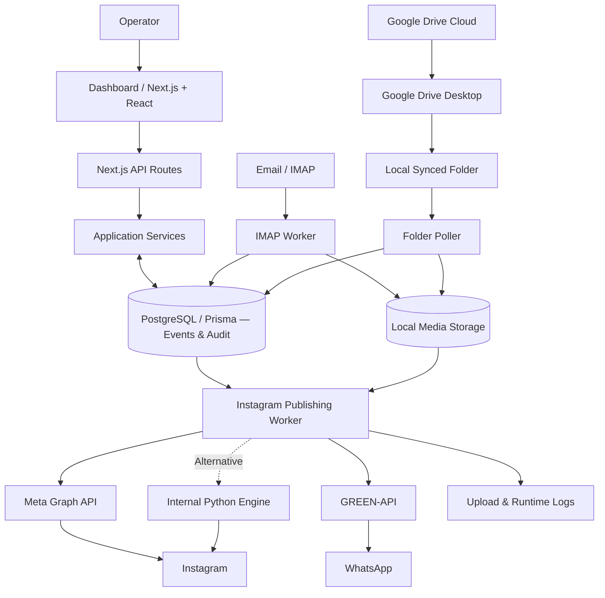

# IMPLEMENTATION PLAN — AUTO-SOSMED / INTERACTIVE SYSTEM ARCHITECTURE

> **Untuk Claude Code — implementasi di WEBSITE PORTOFOLIO yang sudah ada.** Bukan membuat PPT, bukan membangun ulang aplikasi Auto-Sosmed, bukan redesign website. Dokumen ini meneruskan `PLAN_INTERACTIVE_SCROLL_WORKFLOW_AUTO_SOSMED.md` dan `PLAN_KEY_FEATURES_AUTO_SOSMED_PORTFOLIO.md`.

## 0. Misi utama

Bangun section **System Architecture** untuk halaman case study proyek **Auto-Sosmed**: diagram arsitektur **interaktif, responsive, scroll-aware**, mampu menerangkan relasi frontend, API, database, worker background, storage, dan integrasi eksternal secara visual. Desain harus terlihat seperti **engineering portfolio yang dirancang dengan cermat**, bukan infografik SaaS generik. Interaksi harus membantu memahami data flow, bukan sekadar bergerak.

**Sangat penting:** di website portofolio saya sudah ada referensi desain, komponen, theme, dan animasi. **Audit repository sebelum coding.** Ikuti sistem font, warna, spacing, border, radius, icon, motion dan layout yang sudah ada. Jangan menebak stack situs portofolio. Next.js merupakan **stack produk Auto-Sosmed**, tidak otomatis stack website portofolio.

## 1. Fase 0 — Audit existing repository (wajib)

1. Temukan route detail Auto-Sosmed, pola sections case study, layout container, typography, design tokens, CSS variables, light/dark theme dan breakpoints.
2. Periksa implementasi referensi interaktif yang user maksud di repo: scroll-driven reveal, diagram/node connection, sticky panel, progress indicator, active states, tabs, tooltip, dan animasi SVG.
3. Baca komponen **How It Works** dan **Key Features** yang sudah ada/direncanakan. Architecture harus menyambung ritme visual tetapi **jangan mengulang timeline vertikal** dari How It Works atau mengulang feature showcase.
4. Identifikasi stack dan library animasi/diagram yang sudah terpasang. Utamakan HTML/CSS/SVG native dan dependensi yang sudah ada. **Jangan otomatis install React Flow, GSAP, Three.js, framer-motion, atau D3**; hanya pertimbangkan bila repo telah memakainya atau interaksi yang diwajibkan benar-benar membutuhkan.
5. Temukan pola implementasi `prefers-reduced-motion`, accessibility, keyboard, scroll restoration, dan SSR/hydration.
6. Cari aset visual aktual / icon set yang tersedia, jangan mengarang logo atau screenshot produk.
7. Laporkan hasil audit singkat beserta file referensi yang digunakan, token theme, library yang dipilih dan alasan sebelum memaparkan perubahan.

## 2. Sasaran dan prinsip UX

- Diagram menjadi jawaban atas pertanyaan **“bagaimana sistem ini disusun dan bagaimana komponen saling berkomunikasi?”**, bukan pengulangan proses bisnis.
- Hierarki visual utama: **Control Plane (Dashboard + API + Service)**, **Data / State (PostgreSQL + Local Storage)**, **Background Processing (Intake workers + Publisher)**, **External Integrations**.
- Desktop: satu diagram arsitektur cukup lapang; pengguna dapat mengarahkan pointer, fokus keyboard, atau memilih node untuk melihat deskripsi ringkas di panel detail kontekstual.
- Scroll: diagram mulai dari overview, lalu menonjolkan 3–4 lapisan secara berurutan saat section dilalui; setelah selesai, diagram tetap bisa dieksplorasi tanpa auto-animation yang mengganggu.
- Mobile: tampilkan diagram berlapis dengan komposisi vertikal, teks terbaca, koneksi sederhana; **tidak boleh memaksa pinch-zoom atau horizontal scroll untuk memahami arsitektur**.
- Buat visual **tenang dan presisi**. Gunakan garis 1px/tebal mengikuti theme, grid spacing konsisten, restrained accent, label rapi, banyak negative space.
- Bukan neon, orbiting particles, pulsing blobs, glassmorphism tak berdasar, gradient aurora, emoji dekoratif, moving background, atau kartu seragam berlebihan.

## 3. Fakta arsitektur yang wajib akurat

Berikut bersumber dari `BAHAN-PPT-AUTO-SOSMED.md`; cek implementasi repository Auto-Sosmed bila source code juga tersedia, dan **jangan klaim status runtime/produksi dari sekadar source code**.

| Layer | Komponen | Fungsi / relasi |
|---|---|---|
| Operator | Browser/operator | Mengonfigurasi saluran, memantau event dan log |
| Web | Next.js + React Dashboard | UI dan interaksi operator |
| API | Next.js Route Handlers | Mengakses layanan aplikasi |
| Service | Service modules | Konfigurasi saluran, event, akun, penjadwalan dan kontrol |
| State | PostgreSQL + Prisma | Menyimpan channel/config, event queue, status, audit dan upload logs |
| Content input A | IMAP server → IMAP worker | Polling email, filter metadata/lampiran, baseline UID, simpan media dan event |
| Content input B | Google Drive cloud → **Google Drive Desktop → folder Windows** → local folder poller | Sinkronisasi cloud dilakukan aplikasi Drive Desktop; worker aplikasi **membaca filesystem lokal**, bukan cloud Google Drive API pada alur utama |
| Binary media | Local media storage | Berkas media, file hasil salinan/konversi; DB menyimpan path/metadata |
| Publishing | Instagram scheduling/publishing worker | Mengambil event jatuh tempo dari DB, mengambil media, memvalidasi/mempersiapkan dan mengirim |
| Provider utama wizard baru | META / Instagram Graph API | Mengirim container dan publikasi Instagram |
| Provider alternatif | INTERNAL / Python engine & cookie | Jalur alternatif berbasis sesi/cookie; jangan digambarkan setara dari sisi semantik hasil |
| Output | Instagram | Target publikasi |
| Notification | GREEN-API → WhatsApp | Notifikasi proses unggah, sukses atau gagal |
| Observability | Database audit & runtime logs | Jejak status dan diagnostik |
| Runtime | Node.js, Python supervisors, Windows Task Scheduler | Mengoperasikan web/worker sesuai konfigurasi; **website yang hidup bukan berarti worker hidup** |

**Penting:** Jangan menambahkan Redis/RabbitMQ/Kafka atau microservices yang tidak ada. **Event queue berada di PostgreSQL**, bukan message broker eksternal. Jangan menggambarkan cloud Drive terhubung langsung ke Drive worker. Jangan menyamakan status `PUBLISHED` pada provider INTERNAL dengan bukti pasti sudah tampil di Instagram. Jangan mengklaim Threads, X, TikTok dan YouTube sebagai pipeline publikasi end-to-end. Tidak ada generator konten AI pada alur utama yang diverifikasi.

## 4. Model diagram yang harus dibuat

Gunakan **tiga zona utama dengan sub-kelompok**, bukan mind map acak:

**Zona A — Control Plane**
`Operator → Dashboard (Next.js/React) → API Routes → Application Services ↔ PostgreSQL`

**Zona B — Background Pipeline**
`Email/IMAP → IMAP Worker ↘`
`Google Drive cloud → Drive Desktop → Local Folder → Folder Worker ↗`  
`Workers → PostgreSQL (metadata + scheduled events)` dan `Workers → Media Storage (binary files)`  
`PostgreSQL + Media Storage → Instagram Publishing Worker`

**Zona C — External Delivery & Feedback**
`Publishing Worker → META Graph API → Instagram` (jalur utama)  
`Publishing Worker → INTERNAL Python Engine → Instagram` (jalur alternatif, diberi badge/label alternatif bila sesuai theme)  
`Publishing Worker → GREEN-API → WhatsApp`  
`Publishing Worker → Database Logs / File Logs`

Diagram perlu merepresentasikan **aliran kendali versus aliran data** secara jelas jika visual memungkinkan, misalnya legend kecil untuk `control/config`, `metadata/event`, `media`, `external request`. Jangan buat terlalu banyak warna; variasi koneksi dapat menggunakan line pattern, ketebalan atau label yang masih aksesibel.

### Diagram konseptual (referensi konten, bukan render final)

Catatan: jangan embed diagram Mermaid default sebagai UI final jika styling dan layout tidak sesuai design system. Render sebagai markup/SVG yang menyatu dengan website; diagram Mermaid di atas hanya spesifikasi struktur dan relasi.

## 5. Desain visual yang ditargetkan

### 5.1 Section composition

- Eyebrow kecil sesuai komponen yang sudah ada: `SYSTEM DESIGN` / `ARCHITECTURE`.
- Heading ringkas misalnya **“Built around independent background workers.”**; ubah bahasa mengikuti konsistensi portofolio.
- Lead dua kalimat menjelaskan pemisahan dashboard, state, dan pemrosesan asinkron tanpa klaim yang berlebihan.
- Bagian utama: architecture canvas, tidak terlalu tinggi, dengan hierarki grup dan jalur yang mudah dipindai.
- Satu panel ringkas penjelasan **selected node** atau **active layer**, tidak lebih dominan dari diagram.
- Footer kecil `Design decisions` dengan maksimum 3 poin penting: **PostgreSQL-backed queue**, **worker isolation**, **filesystem-based Drive sync**.

### 5.2 Nodes

- Node berupa **satu keluarga komponen** dengan variasi minimal berdasarkan peran: source, process, state, destination.
- Keterbacaan lebih penting daripada banyak icon. Nama node ditampilkan utuh, sublabel 1 baris.
- Active state gunakan token border/text/accent yang sudah ada; inactive jangan disembunyikan hingga informasi hilang.
- Semua ikon dari icon library yang sudah ada. Tidak menggunakan aset/emoji generik yang bertabrakan dengan tampilan portfolio.

### 5.3 Edges

- Utamakan `<svg>` dengan garis/path deterministik yang melekat pada posisi node. Pertimbangkan layout desktop dan mobile terpisah bila lebih stabil daripada menghitung posisi secara imperatif.
- Ketebalan, dash, stroke dan konektor konsisten dan tetap terlihat dalam dark/light mode.
- Active path diwarnai menggunakan theme accent saja; node dan garis lain tetap terlihat sebagai konteks.
- Tidak ada garis terputus karena ukuran font, zoom browser, atau perubahan lebar viewport.

## 6. Interaksi — meaningful, bukan animasi dekoratif

### A. Layer focus on scroll

Empat tahap fokus sepanjang section (rentang dan ambang disesuaikan setelah diuji):

1. **Interface & Control** — Sorot operator → dashboard → API → services.
2. **Source & Intake** — Sorot IMAP dan Drive Desktop → kedua worker, media storage.
3. **Scheduling & State** — Sorot hubungan worker → PostgreSQL event queue → publishing worker; tampilkan peran state.
4. **Delivery & Observability** — Sorot provider ke Instagram, GREEN-API ke WhatsApp, dan logs.

Saat scroll turun, urutan fokus mengikuti tahap. Saat scroll naik, fokus kembali dengan benar. **Jangan scroll hijacking** atau memaksa viewport snap. Diagram boleh sticky hanya bila pola existing page mendukung dan tidak membuat section terlalu panjang.

### B. Hover, focus, click

- Hover atau keyboard focus: sorot **node + jalur koneksi yang langsung relevan**; redupkan komponen lain sedikit tetapi tetap dapat dibaca.
- Click/tap node: kunci pilihan node, tampilkan deskripsi singkat, tanggung jawab, input/output, contoh relasi. Node yang dipilih dapat diganti; sediakan cara `Reset view` bila perlu.
- Prioritas state: **selected node > hovered/focused node > scroll layer**. Setelah pilihan direset, kembali ke layer dari scroll.
- Jangan memicu perubahan layout besar ketika node diklik; panel detail punya ruang stabil.
- Komponen **noninteraktif** tidak boleh tampak bisa diklik.

### C. Active path animation

- Jika theme existing mengizinkan motion, tampilkan **progressive stroke reveal** pada konektor layer aktif dengan durasi pendek/easing sesuai motion token.
- Diperbolehkan satu penanda yang berjalan **hanya saat transisi focus** dan hanya jika jelas membantu menggambarkan arah aliran; tanpa loop terus-menerus.
- Animasi harus tetap bermakna saat scroll cepat, resize, atau tab background. Jangan pakai `setInterval` untuk animasi koneksi.
- `prefers-reduced-motion: reduce`: tanpa gerakan sepanjang path; state aktif berubah instan.

## 7. Detail node ketika dipilih — copy faktual pendek

| Node | Penjelasan singkat yang boleh ditampilkan |
|---|---|
| Dashboard | Panel untuk mengatur akun, channel, konfigurasi dan melihat status event. |
| API & Services | Menerima aksi UI dan mengelola aturan aplikasi serta akses ke database. |
| PostgreSQL | Menyimpan konfigurasi, event terjadwal, status pemrosesan, dan audit. |
| IMAP Worker | Memeriksa pesan baru, menyaring lampiran, dan menyiapkan event dari email yang cocok. |
| Google Drive Desktop | Menyinkronkan file cloud ke folder Windows yang dapat dibaca oleh sistem. |
| Folder Worker | Memantau file lokal, memeriksa kesiapan dan pola file, lalu mencatat event. |
| Media Storage | Menyimpan berkas media lokal; metadata dan path dicatat di database. |
| Publishing Worker | Memilih event sesuai jadwal dan aturan, menyiapkan media, lalu meminta publikasi. |
| META Graph API | Jalur publikasi utama pada wizard channel baru. |
| INTERNAL Engine | Provider alternatif berbasis sesi/cookie dan engine Python. |
| GREEN-API | Menyalurkan notifikasi proses unggah melalui WhatsApp. |
| Logs | Menyimpan jejak aktivitas, hasil, dan error untuk penelusuran masalah. |

## 8. Responsiveness

**Desktop ≥ breakpoint existing:** diagram horizontal/berzona dengan panel detail di samping atau bawah; maksimal mengikuti content width halaman portofolio, bukan full-bleed wajib. Koneksi tidak menabrak teks.

**Tablet:** kurangi kompleksitas silang; rapikan ke stack/zona dua kolom bila masih terbaca; panel detail di bawah.

**Mobile:** render grouping vertikal dengan connector pendek sederhana, tetap bisa pilih node. Jika SVG koneksi desktop tidak masuk akal di mobile, gunakan markup versi mobile dengan data source bersama—jangan paksa canvas lebar yang harus digeser. Tidak ada hover-only explanation.

**Small-screen and large-text testing:** tes lebar 320px, 375px, 768px, desktop 1280px+, browser zoom 200%, dan teks yang membungkus. Jangan hardcode posisi node yang rapuh terhadap panjang label.

## 9. Teknik implementasi dan performance

1. Ikuti framework website portofolio yang ditemukan, bukan asumsi Next.js. Gunakan komponen, utilities, dan tokens yang sudah ada.
2. Representasikan node/edge/layer dalam satu **typed data model** terpisah dari render. `id`, `label`, `group`, `description`, `links`, `kind`; hindari penulisan hubungan di banyak tempat.
3. SVG untuk edges; DOM/HTML semantik untuk teks/interaksi. Posisi dapat berasal dari layout CSS dan titik jangkar terukur, atau dari viewBox deterministik yang diuji. Hindari reflow loop.
4. Scroll focus gunakan `IntersectionObserver` untuk tahap diskret atau mekanisme scroll progress existing yang sudah terbukti. Bila butuh pixel-perfect stroke fill, manfaatkan scroll progress yang sudah disediakan project. Hindari global scroll listener unthrottled.
5. Animasi murah: `opacity`, `transform`, SVG stroke yang terbatas; jangan menjalankan animasi filter/blur/shadow mahal terus-menerus.
6. Pemilihan node jangan memicu render ulang seluruh halaman. Bersihkan observers/listeners saat unmount; aman terhadap SSR dan route transitions.
7. Jika komponen berat, lazy-load sesuai konvensi repository, tetapi pastikan konten inti dapat dibaca tanpa JavaScript motion.
8. Jaga layout stability; hindari CLS dari panel penjelasan/asset. Tidak perlu network fetch eksternal untuk menggambar arsitektur.
9. **Jangan install package baru kecuali benar-benar terbukti dibutuhkan**, jelaskan alasan dan ukur dampaknya.

## 10. Aksesibilitas

- Diagram memiliki judul dan ringkasan tekstual di luar grafis.
- Node yang clickable gunakan elemen interaktif nyata (button atau setara), label yang jelas, focus ring terlihat, keyboard Enter/Space, serta `aria-pressed`/state sesuai perilaku.
- Urutan tab mengikuti narasi logis: Control → Input → State → Publish → Outputs.
- Status layer tidak hanya disampaikan lewat warna. Gunakan label focus yang terbaca.
- Perubahan panel detail tidak menyebabkan focus melompat. Hindari announcements yang terlalu ramai.
- Reduced-motion menghentikan path animation dan smooth scrolling non-esensial.
- Kontras mengikuti token aksesibel dari situs dan diuji pada kedua tema.

## 11. Integrasi dengan dua section sebelumnya

- **How It Works** sudah menyajikan workflow publikasi dalam bentuk timeline scroll vertikal. System Architecture **tidak mengulang format tersebut**; fokus pada pembagian komponen dan konektivitas.
- **Key Features** sudah menyajikan kapabilitas produk. System Architecture menjelaskan bagaimana kapabilitas itu dikonstruksi, bukan mengulang keenam kartu/feature showcase.
- Gunakan section heading, vertical rhythm, scroll threshold, easing, dividers dan navigasi dari halaman case study yang sama.
- Jangan ubah global theme/route/layout untuk kepentingan section baru.

## 12. Urutan implementasi (fase kerja)

### Fase 1 — Audit & planning
- Temukan referensi desain/animasi existing, periksa route dan section lain, catat komponen yang akan dipakai ulang.
- Petakan model node/edge dari fakta arsitektur di dokumen ini.

### Fase 2 — Static architecture (functional first)
- Bangun grouping diagram, konektor, heading, ringkasan, dan ringkasan tekstual.
- Pastikan diagram akurat serta terbaca pada desktop/mobile tanpa animasi.

### Fase 3 — Node exploration
- Tambahkan hover, focus, click/tap, selected-state, panel detail dan reset.
- Pastikan keyboard, aria state dan touch interaction.

### Fase 4 — Scroll-driven focus
- Hubungkan 4 layer ke scroll; aktifkan path/node penekanan secara reversible.
- Integrasikan reduced motion dan hindari benturan dengan sticky/scroll interaksi How It Works.

### Fase 5 — Optimization & QA
- Cek responsive, overflow, konektor yang patah, light/dark themes, CLS, navigasi keyboard, scroll cepat dan cleanup.
- Jalankan lint/typecheck/build/test yang relevan.

## 13. Acceptance criteria (harus lolos)

- [ ] Section hadir pada halaman detail **Auto-Sosmed**, bukan pada semua proyek tanpa alasan.
- [ ] Memakai theme, font, spacing, icon dan animasi asli dari portfolio.
- [ ] Ada **komponen utama: Dashboard/API/Services, IMAP Worker, Drive Desktop + Folder Worker, PostgreSQL, Local Media Storage, Publishing Worker, META, INTERNAL, Instagram, GREEN-API, WhatsApp, Logs**.
- [ ] Panah arsitektur akurat dan tidak mengklaim Google Drive API langsung sebagai input worker.
- [ ] Interaksi node desktop dan touch/mobile benar-benar berfungsi.
- [ ] Scroll mengubah fokus layer; scroll kembali ke atas mengembalikan fokus.
- [ ] State klik punya prioritas jelas atas hover dan scroll; bisa reset.
- [ ] Animasi tidak berlebihan dan reduced-motion berfungsi.
- [ ] Terbaca di mobile tanpa canvas horizontal besar, tanpa elemen menimpa teks.
- [ ] Tidak ada Redis, Kafka, microservices atau AI generation fiktif.
- [ ] Tidak mengubah unrelated sections dan tidak menginstall dependency berat tanpa alasan.
- [ ] Lint/typecheck/build lulus atau kendala yang ada dilaporkan jelas.

## 14. Output Claude Code yang diminta

Pada akhir pengerjaan, rangkum:

1. **Audit:** referensi/theme yang ditemukan dan bagaimana dipakai ulang.
2. **Files changed:** daftar file dibuat/diedit dan alasan singkat.
3. **Interaction mapping:** perilaku scroll, click, hover/focus, mobile, reduced-motion.
4. **Architecture accuracy:** verifikasi data flow dan batas implementasi yang ditampilkan.
5. **Testing:** hasil build/lint, responsive, keyboard, dan isu tersisa.

**Mulai dari audit repository. Implementasikan langsung berdasarkan kondisi project saat ini, bukan berdasarkan tebakan struktur folder atau style.**

---

### Basis konten dan batas klaim

Dokumen ini dirumuskan dari `BAHAN-PPT-AUTO-SOSMED.md` (khususnya slide arsitektur, tech stack, komponen, database, penjadwalan, integrasi, batas fitur, dan deployment), serta diselaraskan dengan rencana section How It Works dan Key Features. Kode produksi dan lingkungan runtime tidak diakses dalam penyusunan plan ini; Claude Code harus mencocokkan klaim dengan repository jika tersedia.
