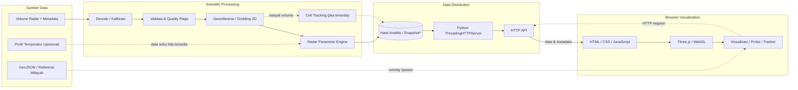

# Implementation Plan — SATRIA-3D OMC Portfolio

> **Target halaman:** `/project/satria-3d-omc` (**placeholder, bukan route terverifikasi**). Brief ini untuk membangun **section System Architecture pada case study portofolio**, bukan dokumentasi deployment final dan bukan instruksi menulis ulang perangkat lunak radar.

**Proyek:** SATRIA-3D OMC — sistem analisis volumetrik radar cuaca tiga dimensi, parameter turunan, dan visualisasi interaktif untuk konteks OMC.

**Sumber kebenaran:** naskah konsep SATRIA-3D OMC membahas Python `ThreadingHTTPServer`, pemrosesan radar, API, HTML/CSS/JavaScript, Three.js/WebGL, data wilayah GeoJSON, serta algoritma radar/SCIT. **Detail topologi runtime, nama modul, penyimpanan, thread pekerja, skema payload, dan urutan eksekusi harus ditentukan dari repository/kode.**

## Tujuan section: System Architecture

Buat **interactive scientific system architecture explorer** yang menjawab **komponen apa berhubungan dengan komponen mana, aliran datanya ke mana, dan mengapa pemisahan lapisan diperlukan**. Ini berbeda dari How It Works (cerita perjalanan satu volume) dan Key Features (kemampuan pengguna). Pertahankan satu diagram yang informatif tanpa interaksi; klik/fokus pada layer menjadi *progressive enhancement*.

**Copy usulan:** `Scientific processing at the core. Interactive 3D analysis at the edge.`

## Layer arsitektur konseptual

| Layer | Node konseptual | Peran | Hubungan data | Status |
|---|---|---|---|---|
| **01 — Observation/Input** | Radar volume files + metadata | Sumber sweeps/rays/gates dan momen radar | File → ingestion | Sumber, tipe `.vol`/`.nc`, dan akuisisi aktual perlu audit |
| **02 — Decode & Quality** | Radar decoder, calibration, quality flags | Memetakan file ke nilai pengamatan dan status kualitas | Raw → normalized polar volume | QC lengkap belum boleh diasumsikan ada |
| **03 — Spatial Processing** | Georeferencing, gridding, voxel data | Transformasi posisi polar → Cartesian/ENU dan pembentukan data 3D | Polar volume → analytical volume | Metode interpolasi dan grid harus dicek |
| **04 — Scientific Engine** | CMAX, ETOP, EBAS, core top, VIL dan derivasi lain | Menurunkan parameter dari pengamatan | Volume 3D → parameter arrays | Hanya parameter terverifikasi dipromosikan |
| **05 — Temporal Analytics** | Cell segmentation & tracking | Menghubungkan sel antarvolume jika riwayat tersedia | Historical volumes → tracks/trends | Label `SCIT-inspired` jika adaptasi |
| **06 — Data Service** | Python / `ThreadingHTTPServer` / API | Menyajikan metadata, volume, parameter, katalog, riwayat | Data hasil proses ↔ HTTP requests | Endpoint dan cache/snapshot aktual perlu validasi |
| **07 — Client/Visualization** | HTML, CSS, JS, Three.js/WebGL | Menampilkan 3D volume, layer geografis, controls, probe | HTTP responses → scene/UI | Fitur interaktif sesuai screenshot/kode |
| **External context (optional)** | Temperature profile / sounding; GeoJSON | Isoterm 0°C dan referensi wilayah | Context → perhitungan termal / peta | Tidak otomatis tersedia dari radar tunggal |

**Jangan menciptakan layer tambahan** seperti PostgreSQL, Redis, WebSocket, Docker, microservices, Kubernetes, cloud object storage, MQTT, orquestration worker queue, ataupun GPU compute server tanpa bukti di proyek. Python server + WebGL browser bukan berarti backend GPU.

## Diagram arsitektur dasar (untuk authoring, bukan bukti runtime)



`*` **Snapshot/hasil analitis adalah konsep desain data serving**; jangan menggambar cache/snapshot, database, atau direktori persisten spesifik sebagai komponen implemented tanpa melihat kode.

## Ground truth dan batas interpretasi

- **Format data:** rancangan menyebut `.vol` untuk radar Balikpapan EEC, tetapi struktur format EEC dan file contoh harus diverifikasi. Jangan otomatis memetakan semua `.vol` ke spesifikasi vendor tertentu.
- **Data source:** jangan menyatakan *live radar streaming* jika mekanisme ingest yang ada sebenarnya membaca hasil ekspor volume periodik.
- **Sensor capabilities:** reflektivitas, velocity, spectrum width tersedia hanya jika volume/konfigurasi menyediakan momen tersebut. Freezing level bukan pengukuran reflektivitas radar.
- **Scientific engine:** CMAX/ETOP/EBAS adalah produk reflektivitas/geometri; VIL/VILD/LWC adalah estimasi berbasis asumsi; WCD memerlukan informasi suhu dan basis awan yang benar; updraft/convergence adalah proxy bila digunakan.
- **Temporal analytics:** tracking memerlukan deret volume dan pencocokan identitas; tidak semua volume menghasilkan history/nowcasting.
- **ThreadingHTTPServer:** menyediakan handling request berbasis thread; **bukan** bukti pipeline compute multithreading, auto-retry, hardening, atau keamanan produksi.
- **Client:** Three.js/WebGL melakukan **rendering**, bukan membuktikan komputasi parameter meteorologi dilakukan di GPU.
- **Performance:** angka ~20.000 instance, interval grid 250 m, dan 60 FPS dalam rancangan adalah target/spesifikasi yang perlu benchmark.
- **Security:** `http.server` tidak otomatis aman untuk exposure internet; jangan memberikan badge *production secure*.
- **Network:** HTTP request/response, bukan WebSocket/streaming dua arah kecuali kode membuktikannya.

## Visual design — interactive architecture explorer

- Diagram desktop minimal menggunakan susunan berlapis **Input → Scientific Processing → Data Service → Browser**, dengan jalur opsional dari suhu lingkungan dan GeoJSON.
- Tampilkan **panah padat** untuk aliran data utama, **panah putus-putus** untuk proses kondisional dan sumber eksternal, dan legenda kecil tanpa warna dekoratif.
- Klik/fokus layer: highlight node dan konektor yang relevan; panel detail berubah sesuai pilihan. Kontrol harus berupa HTML `<button>` atau elemen semantik; tidak cukup click handler pada `svg:path`.
- **Panel detail** untuk node aktif memuat:
  - `Role` — tugas modul.
  - `Input` — tipe data yang diterima.
  - `Output` — struktur data yang dihasilkan.
  - `Verification` — bukti kode, contoh payload, atau `requires audit`.
  - `Notes` — asumsi/ketergantungan ilmiah bila ada.
- Status node tidak harus badge warna mencolok; teks kecil “berdasarkan rancangan” sudah cukup bila belum diverifikasi.
- Gunakan animasi edge hanya ketika pengguna memilih node. Tidak ada partikel yang mengalir tanpa henti, garis neon, atau paralaks yang mengganggu.
- Desktop: diagram lebar + panel samping dengan ukuran proporsional; sticky opsional berdasarkan struktur halaman.
- Mobile: ganti menjadi stack lapisan yang mempertahankan hubungan dan ringkasan data-flow; tidak boleh horizontal overflow.
- Konten node harus tetap bisa dibaca bila JS interaktif gagal atau `prefers-reduced-motion` aktif.
- Warna status kualitas dan aliran harus aman untuk grayscale/print serta aksesibilitas.

## Rincian node untuk panel

### Radar Data Source
**Role:** memasok hasil pemindaian dalam sweep–ray–gate beserta metadata stasiun dan waktu.  
**Input:** volume dari sumber data eksternal.  
**Output:** berkas yang dibaca decode engine.  
**Verification:** nama alat, tipe file, real-time vs batch, sample radar.

### Decoder / QC
**Role:** parsing format dan kalibrasi, menyimpan mask data hilang/suspect.  
**Input:** byte/rekaman asli.  
**Output:** volume polar dengan nilai meteorologis dan status.  
**Verification:** kode mapping byte-to-dBZ; kode QC yang benar-benar ada.

### Spatial Grid
**Role:** referensi ruang, transformasi Earth-effective geometry jika diimplementasikan, dan voxel sampling.  
**Input:** polar observations + geometri.  
**Output:** data spasial 3D beserta dukungan observasi/missing mask.  
**Verification:** fungsi transformasi, skala ENU ↔ Three.js, grid spacing, metode interpolasi.

### Scientific Engine
**Role:** menghasilkan parameter berdasarkan pengukuran dan formulasi.  
**Input:** radar volume, konfigurasi threshold, data eksternal opsional.  
**Output:** product arrays dan metadata variabel.  
**Verification:** daftar fungsi aktual; bukti pengujian numerik.

### Cell Tracker
**Role:** identifikasi dan asosiasi sel dari beberapa volume.  
**Input:** sejarah volumes dan atribut objek.  
**Output:** ID sel, centroid, lintasan, tren (jika valid).  
**Verification:** algoritma segmentasi, matching, split/merge, nowcast.

### Python HTTP API
**Role:** menyajikan produk radar serta metadata kepada browser.  
**Input:** hasil pengolahan atau struktur penyimpanan yang ada.  
**Output:** HTTP response.  
**Verification:** `server.py`, routes, payload sebenarnya, concurrency assumptions.

### Three.js Client
**Role:** interpretasi visual, kontrol kamera, pemilihan voxel, overlay panel.  
**Input:** response API yang tervalidasi, koordinat, GeoJSON.  
**Output:** scene dan UI.  
**Verification:** `index.html`, stylesheet, script, InstancedMesh, Raycaster, recorder.

## Endpoint dalam rancangan — jangan tampilkan sebagai kontrak final

| Endpoint disebut dalam draf | Peran konseptual | Yang perlu dicek |
|---|---|---|
| `/api/status` | Status server / status radar | keys status, uptime, error |
| `/api/catalog` | Katalog produk | daftar produk aktual, filtering |
| `/api/radar3d/latest` | Data volume 3D terbaru | shape, size, compression, timestamps |
| `/api/radar3d/cell_history` | Riwayat sel | ID/lat-lon, horizon, ketersediaan |
| `/target_admin_boundaries.json` | GeoJSON overlay wilayah | source, projection, public access |

## Saran data model UI

```ts
type ArchitectureNode = {
  id: string;
  label: string;
  layer: 'input' | 'scientific' | 'temporal' | 'service' | 'client' | 'external';
  role: string;
  input: string;
  output: string;
  verification: 'verified-in-code' | 'described-in-design' | 'requires-verification';
};

type ArchitectureEdge = {
  from: string;
  to: string;
  condition?: string; // contoh: 'jika riwayat volume tersedia'
};
```

*Sesuaikan tipe data dengan framework dan bahasa aplikasi portofolio existing; jangan menambah TypeScript hanya karena contoh ini menggunakan TS.*

## Fase eksekusi

1. Audit halaman portofolio: route aktual, komponen graph, theme, state management, animasi existing, viewport, interaksi keyboard.
2. Audit kode SATRIA: `server.py`, frontend scripts, data pipeline modules, file radar, dependencies, API payload, processing order, dan screenshot.
3. Koreksi diagram konseptual berdasarkan hasil audit; hapus node atau edge yang tidak bisa didukung.
4. Buat data `nodes` dan `edges` yang terpisah dari rendering serta dapat direvisi tanpa menulis ulang SVG.
5. Implementasikan arsitektur sebagai SVG/HTML ringan + panel fokus, bukan aplikasi radar penuh.
6. Uji semua arah panah, kondisionalitas data eksternal, keyboard, mobile, reduced motion, dan hasil screenshot.

## Acceptance khusus

- Pembaca memahami perbedaan **pemrosesan ilmiah di Python** dan **visualisasi grafis di Three.js**.
- Semua konektor sesuai urutan data yang dapat dibuktikan atau diberi label *conceptual*.
- Data termodinamika eksternal dan pelacakan multitemporal terlihat sebagai **input/fungsi kondisional**.
- HTTP request dan response memiliki arah yang benar.
- Tidak menyiratkan database, cloud, keamanan produksi, streaming, atau komputasi GPU backend yang tidak terkonfirmasi.
- Section tidak sekadar mengulang tujuh step How It Works.

## Aturan wajib sebelum coding

1. Verifikasi route dan layout dari repository portofolio. Jangan buat route duplikat.
2. Verifikasi kode SATRIA untuk menandai implemented vs design; jangan menggunakan monograf sebagai bukti otomatis.
3. Jangan mencantumkan arsitektur berdasarkan library penelitian (mis. Py-ART/wradlib) seolah dependency aplikasi tanpa `requirements` atau import nyata.
4. Jangan mengekspos alamat host, port internal, storage path, source data yang dibatasi, atau konfigurasi autentikasi.
5. Reuse CSS tokens dan libraries existing; jangan memperkenalkan framework diagram hanya untuk satu section.
6. Penuhi mobile, keyboard, focus-visible, kontras, alt text, dan reduced-motion.
7. Hindari fabricated logs, metrics, service replicas, atau status ‘healthy’ seolah pemantauan produksi.

## Definition of done

- Diagram layer dan hubungan data SATRIA-3D OMC dapat dipahami tanpa interaksi.
- Node selectable mempunyai panel detail yang akurat dan aksesibel.
- Endpoint dan asumsi ditampilkan dengan status bukti yang proporsional.
- Screenshot review desktop/mobile dan build/lint/test lulus sesuai alat yang tersedia.
- Ringkas source yang diaudit, file yang berubah, dan celah verifikasi yang belum dapat diselesaikan.
