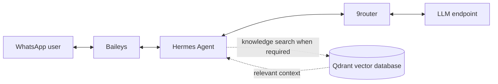

# Implementation Plan — WhatsApp AI Agent Portfolio

> Target halaman: `/project/whatsapp-ai-agent` (verifikasi route aktual di repository). Dokumen ini adalah brief untuk Claude Code mengimplementasikan **section halaman case study portofolio**, bukan deck presentasi atau instruksi membangun backend agent.

**Proyek:** WhatsApp AI Agent menggunakan Hermes Agent, Baileys, 9router, dan Qdrant sebagai vector knowledge database.

**Ketepatan fakta:** alur rinci antara Hermes, 9router, Qdrant, dan service penghubung harus diperiksa di repository agent jika tersedia. Pada situs portofolio, bedakan `Implemented`, `Architecture concept`, dan `Planned` berdasarkan bukti, bukan asumsi.

## Tujuan section: System Architecture
Perlihatkan hubungan komponen agent, transport WhatsApp, penyedia inferensi, dan knowledge vector store dalam satu **interactive architecture explorer**. Diagram ini menjawab **apa terhubung ke apa dan mengapa**, bukan mengulang tahapan How It Works.

## Layer konseptual
1. **Messaging layer**: pengguna WhatsApp dan koneksi Baileys.
2. **Agent layer**: Hermes Agent; adapter/bridge **hanya jika repo membuktikan ada service pemisah**.
3. **Model access layer**: 9router dan endpoint model yang benar-benar dipakai (jika nama model tidak boleh dipublikasi, cukup `LLM endpoint`).
4. **Knowledge layer**: Qdrant vector collections; embedding/indexer **hanya ditampilkan bila terbukti**.
5. **Operational layer (conditional)**: logging/session store/monitoring hanya bila terdapat di implementasi.

## Ground truth dan batas interpretasi
- Hermes Agent dapat memiliki gateway WhatsApp sendiri pada berbagai setup. Karena pengguna mengatakan Hermes terhubung ke Baileys, jangan menciptakan bridge tambahan atau dua gateway tanpa bukti. Audit lokasi listener Baileys dan titik panggil Hermes.
- Qdrant adalah tempat vector knowledge; jangan menyatakannya menyimpan seluruh chat, PII, atau full raw documents tanpa verifikasi schema/payload.
- 9router jangan digambarkan sebagai model LLM itu sendiri; tunjukkan posisinya sesuai integrasi aktual. Jangan klaim fallback, load balancing, atau provider tertentu tanpa bukti.
- Retrieval dapat berupa tool Hermes, sidecar RAG service, atau middleware. Tempatkan konektor Qdrant sesuai kode nyata. Jika repo agent tidak tersedia, label diagram `Conceptual integration`.

## Diagram dasar untuk authoring (adjust setelah audit)

Jangan tempel Mermaid mentah di UI akhir jika referensi portfolio memakai custom nodes. Buat SVG/HTML agar konsisten dengan theme dan dapat diakses.

## Konsep interaksi
- Diagram statis tetap informatif pada awalnya; interaktivitas sifatnya progressive enhancement.
- Layer label seperti `Messaging`, `Agent`, `Model`, `Knowledge` dapat diklik atau difokuskan; highlight node terkait dan edge yang benar, sisanya meredup ringan.
- Panel detail yang *berubah berdasarkan node pilihan* menampilkan: role, input, output, integration notes, dan verification status; tanpa merender data sensitif.
- Scroll-aware highlighting dapat mengikuti deskripsi 4 layer, tetapi tidak memaksa full-screen scroll snap.
- Highlight edge singkat/on-demand; jangan animated packets terus-menerus. Penuhi reduced-motion.
- Desktop: diagram luas dan informasi samping, sticky hanya bila tidak mengganggu. Mobile: layered vertical graph atau stack yang mempertahankan koneksi dan tombol detail tanpa overflow.
- Untuk node clickable gunakan button asli / semantik keyboard dan `aria-pressed` yang sesuai, bukan handler click pada SVG path tanpa dukungan keyboard.

## Konten panel node (template)
- **Baileys:** jembatan pesan WhatsApp ↔ aplikasi.
- **Hermes:** pemrosesan instruksi dan pengambilan langkah agent sesuai implementasi.
- **9router:** akses model melalui konfigurasi routing yang digunakan proyek.
- **Qdrant:** pencarian representasi vektor pengetahuan untuk konteks jawaban.
- **LLM endpoint:** menghasilkan respons berdasarkan prompt dan konteks terpilih (provider/model hanya jika ada bukti).

## Fase eksekusi
1. Audit repository portofolio dan, jika tersedia, source proyek AI agent; cari konfigurasi 9router, Baileys event handler, Hermes adapter, Qdrant client, ingestion pipeline, dan logging.
2. Tentukan node/edge tepat berdasar source; hapus semua kotak spekulatif.
3. Implementasikan graph yang responsive dan panel fokus berbasis state tunggal.
4. Sinkronkan scroll focus opsional dengan kontrol klik tanpa saling overwrite yang membingungkan.
5. Verifikasi keyboard, focus, kontras, performa, dan reduced-motion.

## Acceptance khusus
- Diagram tidak menyiratkan bahwa Qdrant selalu dipanggil pada setiap pesan.
- Directionality masuk/keluar konsisten, dan aliran retrieval berbeda dari aliran respons WhatsApp.
- Architecture section jelas berbeda dari timeline workflow.

## Aturan wajib sebelum coding
1. Audit repository portofolio: temukan route yang benar untuk `/project/whatsapp-ai-agent`, layout, komponen, design tokens, font, breakpoints, motion utilities, dan referensi section dari proyek Auto-Sosmed/ATMOS. Jangan menebak framework atau membuat route duplikat.
2. Prioritaskan reuse komponen dan library yang telah terpasang. Jangan menambah dependency animasi/diagram hanya untuk efek dekoratif.
3. Ikuti theme aktif (termasuk dark/light jika ada), warna, ukuran teks, border, spacing, radius, dan rhythm existing. Jangan memaksakan palet ungu/neon atau estetika chatbot generik.
4. Implementasikan di halaman portofolio yang sudah ada, **bukan** demo atau aplikasi WhatsApp baru. Perubahan harus scoped; jangan memodifikasi theme global atau section lain tanpa alasan.
5. Cari screenshot/asset asli jika ada. Jika tidak ada, gunakan visual HTML/SVG yang abstrak dan jujur; jangan mengarang screenshot/chat produksi, metrik, atau badge verifikasi.
6. Gunakan data terstruktur yang mudah diedit, semantic HTML, keyboard-accessible controls, focus-visible, responsive layout, dan `prefers-reduced-motion`.
7. Jangan membocorkan nomor WhatsApp, isi percakapan, API key, embedding, dokumen internal, atau endpoint private. Semua contoh chat harus sintetis dan diberi label contoh.
8. **Jangan menyimpulkan detail yang belum dikonfirmasi sebagai fitur terimplementasi**. Pengguna hanya memastikan: 9router, Hermes Agent, integrasi WhatsApp via Baileys, dan Qdrant untuk knowledge vector database. Audit kode/dokumen proyek AI agent bila tersedia. Bila tidak, tampilkan gambaran arsitektur konseptual dengan frasa aman dan bukan hasil verifikasi implementasi.
9. Pastikan penamaan **9router** konsisten. Jangan otomatis menyamakannya dengan OpenRouter, 9Router tertentu, atau mengklaim routing/failover/token accounting spesifik tanpa bukti dari konfigurasi proyek.

## Definition of done
- Section berada pada route proyek yang tepat dan serasi dengan style situs.
- Semua kontrol berfungsi pada mouse, touch, keyboard; tidak ada interaksi yang bergantung hanya pada hover.
- Layout tidak overflow di lebar 320–390px, tablet, desktop.
- Animasi bisa mundur ketika scroll ke atas, tidak mengganggu navigasi, dan reduced-motion tetap bermakna.
- Tidak ada fakta arsitektur, SLA, privasi, KPI, atau fitur AI yang diklaim tanpa bukti.
- Lint/build/test yang tersedia dijalankan; laporkan file berubah, hasil, dan keterbatasan.
