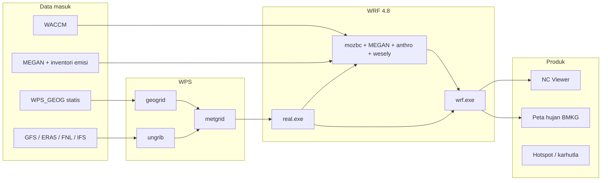
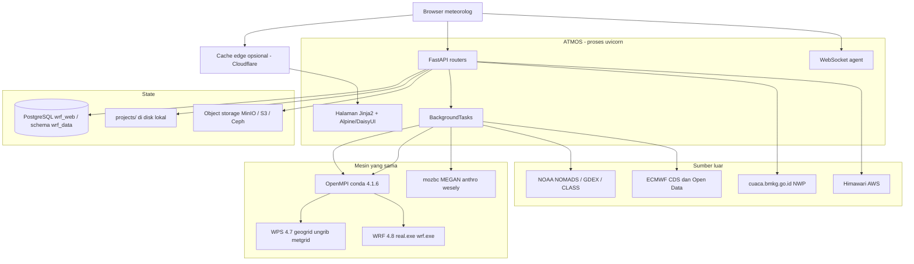

# ATMOS / WRF-WEB

Dokumen presentasi untuk pimpinan. Isi diambil dari kode dan konfigurasi repositori `WRF-WEB` (aplikasi versi `0.1.0`, nama produk **ATMOS**). Bukan proposal; ini deskripsi sistem yang sudah ada.

Layanan dipasang di mesin lokal, port **8000**, dan sudah dijangkau lewat Cloudflare di `https://wrf-web.cyou` (URL itu tertulis di modul unduhan analisis).

Dokumen terkait yang lebih teknis: `ERD.md`, `UML.md`, `docs/erd.md`, `docs/desain-diagram-uml.md`.

---

## 1. Ringkasan eksekutif

ATMOS adalah platform web untuk menjalankan model numerik atmosfer **WRF** dan **WRF-Chem** tanpa mewajibkan pengguna menguasai instalasi, kompilasi, dan baris perintah Linux.

Masalah yang diselesaikan: WRF kuat untuk prakiraan cuaca dan kualitas udara, tetapi alurnya panjang — unduh data global, susun domain, jalankan WPS, REAL, kimia, lalu WRF, baru visualisasi. Banyak waktu meteorolog habis di masalah teknis, bukan di analisis.

Yang sudah dibangun:

- Antarmuka web (bahasa Indonesia) untuk membuat project, mengunduh data, menggambar domain di peta, menjalankan tiap tahap model, memantau log, dan melihat hasil.
- Mesin komputasi di belakang layar: **WRF 4.8.0** dan **WPS 4.7.0**, plus prosesor kimia **mozbc**, **MEGAN**, **anthro_emis**, **wesely / exo_coldens**.
- Katalog project regional yang sudah dijalankan, antara lain Kalimantan, IKN, Kaltim, Kalbar, Jatim, dan OMC.

Kalimat posisi (sudah dipakai di beranda):

> ATMOS tidak menggantikan WRF. ATMOS membuat WRF lebih mudah dioperasikan, sehingga meteorolog, peneliti, dan mahasiswa lebih banyak waktu untuk analisis atmosfer.

---

## 2. Untuk siapa

| Pengguna | Kebutuhan yang dilayani |
|---|---|
| Meteorolog / prakirawan | Domain, unduh data, jalankan WRF, pantau log, peta curah hujan |
| Peneliti kualitas udara | WRF-Chem: syarat batas WACCM, emisi biogenik MEGAN, emisi antropogenik, mekanisme RADM2SORG |
| Analis karhutla | Hotspot satelit (MODIS/VIIRS) dipetakan ke tutupan lahan, layout Kaltim |
| Pimpinan / briefing | Peta siap presentasi, PNG live (radar, satelit), arsip project yang bisa diulang |

Identitas di navbar saat ini label tetap (`IndraZ03 - YSO`). Login multi-pengguna dan peran (role) **belum** diimplementasikan. Kepemilikan project hanya kolom `owner_user` (default `system`).

---

## 3. Apa yang bisa dilakukan (fitur)

### 3.1 Manajemen project

- Buat, daftar, hapus project lewat API `/api/v1/datasets/projects`.
- Tiap project dapat folder fisik di `projects/<KODE>/` plus baris di PostgreSQL (`wrf_data.projects`).
- Preset dataset dipilih saat buat project (default GFS). Folder dataset yang tidak dipilih tidak dibuat.
- Metadata di `configuration/project.json`: versi WRF `4.8.0`, WPS `4.7.0`, `chem_opt` default `2`.

Project yang ada di disk (saat dokumen ini ditulis):

`IKN15-18SEP`, `IKN19-24AGT`, `IKN22-27AGT`, `IKN24-27AGT`, `JATIM25`, `KALBAR14`, `KALIMANTAN-KARHUTLA2026`, `KALTIM11`, `OMC9-10`, `OMC11-12`, `OMC12-13`, `OMC13`, `OMC14-17`, `OMC17-18`.

### 3.2 Unduh data

Halaman `/unduh-data`. Katalog di server:

| Kode | Nama | Format | Peran |
|---|---|---|---|
| GFS | Global Forecast System 0.25° (NOMADS) | GRIB2 | Meteorologi awal (default) |
| ERA5 | ECMWF ERA5 reanalysis (CDS) | NetCDF | Reanalisis, hindcast |
| FNL | NCEP FNL 0.25° (GDEX d083003, 92 parameter) | GRIB2 | Analisis akhir operasional |
| IFS / HRES | ECMWF IFS Open Data, stream `oper`, 0.25° | GRIB2 | Prakiraan global tanpa kunci CDS |
| WACCM | CESM/WACCM chemical boundary | NetCDF | Syarat batas & awal kimia (O3, NO2, …) |
| MEGAN | MEGAN biogenic emissions | NetCDF | Emisi biogenik (isoprene, …) |

Unduhan berjalan di background, progres disimpan di `download_jobs` (status, persen, jumlah file, byte, pesan error). Worker default 4 thread; ERA5 default 8.

Tanggal namelist bisa diset otomatis dari jendela waktu file yang sudah terunduh (`/api/v1/datasets/auto-set-dates/{project}`).

### 3.3 WRF Domain Wizard

Halaman `/domain-wizard`. Editor geometri domain di peta **Leaflet**: bounding box, proyeksi, resolusi, jumlah domain. Hasilnya `namelist.wps` yang bisa disimpan ke folder `configuration/` project.

Endpoint: `/api/v1/domain-wizard/generate-namelist` dan `/save-to-project`.

### 3.4 Dashboard WRF

Halaman `/wrf`. Pipeline 5 node, tiap node bisa Start / Stop / Restart sendiri:

```
geogrid → ungrib → metgrid → real → wrf
```

Yang dilakukan tiap node:

| Node | Program | Hasil |
|---|---|---|
| geogrid | `geogrid.exe` (WPS 4.7, MPI) | `geo_em.d0*.nc` — topografi, tata guna lahan, peta darat/laut |
| ungrib | `ungrib.exe` (serial) | Intermediate `FILE:YYYY-MM-DD_HH` dari GRIB |
| metgrid | `metgrid.exe` (MPI) | `met_em.d0*.nc` — meteorologi di grid model |
| real | `real.exe` (MPI) | `wrfinput_d0*`, `wrfbdy_d01` |
| wrf | `wrf.exe` (MPI) | `wrfout_d0*_…` NetCDF |

Namelist (`namelist.wps`, `namelist.input`) bisa dibaca dan diedit dari UI, per bagian: `time_control`, `domains`, `physics`, `dynamics`, `bdy_control`, `namelist_quilt`.

Namelist bawaan saat project baru dibuat (bisa diubah per kasus):

- Domain: 1, Mercator, pusat Indonesia `ref_lat = -2.5`, `ref_lon = 118.0`, `dx = dy = 10 km`, grid 100 × 100, interval data 6 jam.
- Fisika: WSM5 (`mp_physics = 4`), RRTM/Dudhia (`ra_lw/sw = 1`), YSU (`bl_pbl = 1`), Kain–Fritsch (`cu = 1`), Noah (`sf_surface = 2`).
- Project operasional tidak seragam. OMC dan IKN umumnya 2 domain (induk 9–12 km, nest 3–4 km). Kasus karhutla Kalimantan memakai blok `&chem` penuh. Sebagian run OMC tidak punya blok kimia — itu run cuaca, bukan kualitas udara.

Status job di-poll. Log dibaca dari file fisik, **hanya ekor file** (maks. 8 MB / 500 baris) supaya log `rsl.out` berukuran puluhan GB tidak menumbangkan server.

Riwayat eksekusi bisa dihapus dari tampilan tanpa menghapus jejak waktu selesai (`history_deleted_at`).

### 3.5 Dashboard WRF-Chem

Halaman `/wrfchem`. Pipeline 6 node — sama dengan WRF, plus node **chem** di antara `real` dan `wrf`:

```
geogrid → ungrib → metgrid → real → chem → wrf
```

Alat kimia yang bisa dipilih di UI:

| Alat | Fungsi | Syarat data |
|---|---|---|
| mozbc | Isi syarat batas & kondisi awal kimia dari WACCM ke `wrfinput` / `wrfbdy` | NetCDF WACCM di `datasets/WACCM/` |
| megan | `megan_bio_emiss` — emisi biogenik, LAI bulan simulasi | `geo_em`, data MEGAN sistem |
| anthro | `anthro_emis` — emisi antropogenik dari inventori **EDGAR-HTAP / EPA tahun 2010**, digeser ke tahun simulasi (`data_yrs_offset = tahun − 2010`) | Inventori di mesin komputasi. Bukan inventori emisi Indonesia terkini |
| wesely_coldens | Deposisi kering (`wesely`) dan kolom exo (`exo_coldens`) | `geo_em` |

Mekanisme yang dikenali server, dan `chem_opt` yang ditulis ke `&chem`:

| Berkas `.inp` | `chem_opt` | `emiss_opt` | Catatan |
|---|---|---|---|
| RADM2SORG.inp | 2 | 3 | **Default.** RADM2 + aerosol SORGAM |
| RADM2.inp | 1 | 3 | RADM2 gas |
| RACMSORG.inp | 106 | 3 | RACM + SORGAM |
| RACM.inp | 105 | 3 | RACM gas |
| MOZCART.inp | 112 | 5 | MOZART + GOCART |
| GOCART.inp | 300 | 0 | Aerosol GOCART |
| CBMZ-MOSAIC_4bins.inp | 9 | 4 | CBMZ + MOSAIC 4 bin |
| CBMZ-MOSAIC_8bins.inp | 10 | 4 | CBMZ + MOSAIC 8 bin |
| T1_MOZCART.inp | 114 | 5 | T1 MOZCART |

`bio_emiss_opt = 3` bila MEGAN aktif (MEGAN2 di Registry WRF-Chem 4.8). `have_bcs_chem` menyala bila mozbc dipilih.

Periode acuan ilmiah yang dipakai sebagai contoh konfigurasi: **1–6 Juni 2023, 00 UTC**, domain regional Indonesia, meteorologi ERA5, kimia WACCM, biogenik MEGAN, mekanisme RADM2SORG.

### 3.6 NC Viewer

Halaman `/ncview`. Penampil NetCDF di browser, bukan ncview desktop.

- Buka `wrfout` / `geo_em` / `met_em` dari project, atau unggah berkas.
- Peta variabel, statistik, nilai di satu titik, time series, irisan vertikal (`cross-section`, `vcut`).
- Peta hujan dari `RAINC + RAINNC + RAINSH`, unduh PNG atau ZIP.
- Titik bertanda (mark) tersimpan di database.
- Layer Daerah Aliran Sungai (DAS): polygon GeoJSON, default Semoi, bisa unggah shapefile.
- Overlay radar CMAX (Balikpapan) dan tile satelit yang disinkronkan ke timestep.

### 3.7 Visualisasi curah hujan

Halaman `/visualization`. Peta publikasi dari `wrfout`, skala warna mengikuti **BMKG TP** (`tp.png`). Domain d01/d02, riwayat peta tersimpan, bisa diunduh ulang.

### 3.8 Satelit Himawari-8/9

Tile Web Mercator di atas Indonesia (bbox default `90, -15, 145, 10`).

| Produk | Band | Kegunaan |
|---|---|---|
| `ir_cloud` | C13 (IR 10.4 µm) | Awan / suhu puncak awan |
| `truecolor` | C01–C04 | Warna sejati siang hari |

Sumber historis: NOAA CLASS (perlu akun) dan AWS S3 publik Himawari. Tile disimpan di `satellite_data/`, di luar folder project, supaya tidak ikut terhapus saat project di-reset. Katalog waktu ada di tabel `satellite_tiles`.

### 3.9 Radar dan gambar live untuk briefing

Endpoint gambar tanpa cache panjang (folder `data/live/`, sengaja di luar `/static` agar tidak kena cache 4 jam):

- `/cmax_balikpapan.png`, `/cmax_radar.png` — radar CMAX
- `/himawari-ir.png` — IR Himawari
- `/PAC06_balikpapan.png` — produk radar PAC06

Dipakai untuk disematkan di slide yang harus selalu segar.

### 3.10 NWP viewer BMKG (Kalimantan Timur)

Halaman `/nwp-viewer-bmkg`. Raster BMKG dipotong ke bbox Kaltim (`113.7–119.1°E`, `2.5°S–2.6°N`).

Model: **ECMWF HRES** dan **WRF Kalimantan** (produk `wrfruc`).

Parameter: kelembapan relatif, hujan 1 jam, hujan 24 jam, angin, reflektivitas. Skala warna mengikuti colorbar BMKG.

Halaman terpisah `/ecmwf-hres`: grid Open-Meteo ECMWF IFS HRES di atas peta OSM Kaltim.

### 3.11 Hotspot dan karhutla

- `/hotspot` — hotspot (MODIS Terra/Aqua dan VIIRS SNPP/NOAA-20) ditimpa tutupan lahan **Dynamic World**. Kepercayaan dikategorikan: VIIRS skala 7/8/9, MODIS dalam persen. Keluaran peta per wilayah, bisa diunduh ZIP.
- `/hotspot-kaltim` — layout peta gaya BMKG Karhutla untuk Kalimantan Timur. Unggah berkas hotspot atau pakai data lokal, lalu unduh gambar.

### 3.12 Layer konsesi kayu (WMS)

Layanan WMS internal untuk konsesi serat kayu Indonesia (`Indonesia_wood_fiber_concessions.geojson`). Dipakai sebagai konteks spasial di peta analisis, misalnya menimpa hotspot atau domain model dengan batas konsesi.

### 3.13 Asisten di dalam aplikasi

Widget terminal di UI tersambung lewat WebSocket `/ws/agent/terminal` ke program `hermes` di mesin yang sama. Ini asisten operasional lokal, bukan layanan cloud terpisah.

### 3.14 Berkas project

`/api/project-folders` — daftar dan unduh berkas di folder project (output, log) tanpa login SSH.

---

## 4. Alur kerja operasional

Urutan yang diharapkan pengguna, dari kosong sampai produk analisis.

### Langkah 1 — Buat project

1. Isi kode, nama, deskripsi, preset dataset (GFS, ERA5, WACCM, …).
2. Server menulis baris `projects` dan membuat pohon folder.
3. Namelist default disalin. Executable WPS/WRF **tidak disalin**; yang dibuat symlink ke binary bersama di `/home/stametsepinggan/Build_WRF/`.
4. Template `.inp` mozbc di-symlink ke `configuration/`.

### Langkah 2 — Gambar domain

1. Buka Domain Wizard, tarik kotak domain di peta (bisa nested: d01, d02, …).
2. Simpan `namelist.wps` ke project.
3. Server memastikan `geog_data_path` menunjuk ke data geografi statis bersama (`WPS_GEOG`).

### Langkah 3 — Unduh data

1. Pilih rentang tanggal dan parameter.
2. Job unduhan berjalan di background. GFS dari NOMADS, ERA5 dari CDS, FNL dari GDEX, IFS/HRES dari ECMWF Open Data, WACCM dari arsip kimia.
3. File mendarat di `projects/<KODE>/datasets/<sumber>/`.
4. Metadata waktu dan ukuran bisa dicatat di `object_storage_files` bila bucket object storage dipakai.
5. **Auto Set Tanggal** menyelaraskan `start_*` / `end_*` di namelist dengan jendela file yang ada.

### Langkah 4 — Preprocessing WPS

Jalankan berurutan dari dashboard. Tiap node menulis log sendiri dan baris `wrf_jobs`.

1. **geogrid** — baca `namelist.wps`, pakai `GEOGRID.TBL.ARW_CHEM` (bukan tabel WRF biasa, supaya variabel kimia/biogenik ikut). Keluaran `outputs/geo_em/`.
2. **ungrib** — GRIB di-link. Vtable yang dipasang runner adalah **Vtable.GFS**. ERA5 NetCDF di katalog tidak langsung dimakan ungrib; harus GRIB (atau sudah dikonversi) supaya tahap ini jalan. Timeout 30 menit. File GRIB yang ukurannya di bawah 50% median saudara dianggap rusak dan ditolak.
3. **metgrid** — interpolasi horizontal ke grid domain. Keluaran `outputs/met_em/`.

### Langkah 5 — Inisialisasi WRF

**real.exe** membaca `met_em` + `namelist.input`, menulis `wrfinput` dan `wrfbdy` ke `outputs/wrfinput/` dan workspace `wrf/real/`.

Kunci namelist kimia lama yang tidak dikenal WRF 4.8 dibuang otomatis sebelum real/wrf, supaya run tidak mati karena opsi usang.

### Langkah 6 — Preparasi kimia (hanya WRF-Chem)

Node **chem**, hanya jika simulasi kualitas udara:

1. Server menulis atau mengganti blok `&chem` di `namelist.input` sesuai mekanisme dan alat yang dicentang.
2. `wrfinput` / `wrfbdy` disalin ke workspace; `met_em` dan `geo_em` di-symlink.
3. **mozbc** — file WACCM harian digabung (`ncrcat`) menjadi satu berkas, karena mozbc hanya menaikkan angka terakhir nama file dan buffer nama maksimal 100 karakter. Syarat batas gas dan aerosol diisi.
4. **MEGAN** — bulan LAI diambil dari `start_month` / `end_month` namelist.
5. **anthro** — jendela tanggal dari namelist, inventori EPA / EDGAR-HTAP.
6. **wesely + exo_coldens** — parameter deposisi kering dan kolom.

Log gabungan: `logs/chem_logs/chem_prep.log`, plus log per alat.

### Langkah 7 — Integrasi

**wrf.exe** di `wrf/run/`. Timeout 12 jam (satu jam simulasi kira-kira 10 menit waktu nyata; simulasi 42 jam butuh sekitar 7–8 jam). Log progres di `rsl.out.0000`, di-mirror ke panel UI saat berjalan. Keluaran `wrfout_d01_…` pindah ke `outputs/wrfout/`.

WRF-Chem dengan `chem_opt > 0` pernah jatuh karena ASLR pada binary PIE. Runner membungkus perintah dengan `setarch -R` supaya run kimia stabil.

MPI memakai OpenMPI conda-forge 4.1.6, bukan OpenMPI sistem. OpenMPI sistem 4.1.2 menggantung di WSL2 ini.

### Langkah 8 — Analisis

1. NC Viewer: peta, irisan, time series, titik, DAS.
2. Halaman visualisasi: peta hujan skala BMKG, arsip PNG.
3. Bandingkan dengan radar live, Himawari, NWP BMKG, atau lapisan hotspot/konsesi bila kasusnya karhutla atau cuaca signifikan.

### Langkah 9 — Arsip

Folder project, log, dan riwayat `wrf_jobs` tetap ada. Project lain tidak berbagi namelist atau GRIB; yang dibagi hanya binary, tabel fisika, dan data geografi statis.



Cabang WRF murni melewati REAL langsung ke WRF. Cabang WRF-Chem wajib lewat CHEM.

---

## 5. Arsitektur sistem

Empat lapis. Tidak ada Kubernetes dan tidak ada antrian terpisah (Celery/Redis tidak dipakai).



### 5.1 Lapis tampilan

- Server-rendered HTML (Jinja2). Bukan SPA terpisah.
- Interaksi halaman: Alpine.js, Tailwind CSS, DaisyUI.
- Peta: Leaflet.
- Domain Wizard membawa salinan JS/CSS sendiri (Bootstrap + Leaflet) di `app/static/domain_wizard/`.
- Halaman HTML dikirim `Cache-Control: no-store` supaya perbaikan UI tidak tertahan cache browser atau Cloudflare.

### 5.2 Lapis aplikasi

Satu proses ASGI: `uvicorn app.main:app`. OpenAPI/Swagger dimatikan (`docs_url=None`).

Router:

| Router | Prefiks | Tugas |
|---|---|---|
| datasets | `/api/v1/datasets` | Project, katalog, unduh, namelist, tanggal |
| domain_wizard | `/api/v1/domain-wizard` | Geometri domain → `namelist.wps` |
| wrf | `/api/wrf` | Jalankan/hentikan node, log, riwayat, mekanisme kimia |
| ncview | `/api/ncview` | Buka NetCDF, peta, irisan, hujan, mark, DAS |
| satellite | `/api/satellite` | Produk, tile, render, unduh Himawari |
| visualization | `/api/visualization` | Peta hujan publikasi |
| nwp_bmkg | `/api/nwp-bmkg` | Katalog dan PNG NWP BMKG |
| hotspot_landuse | `/api/hotspot-landuse` | Hotspot × Dynamic World |
| hotspot_kaltim | `/api/hotspot-kaltim` | Layout karhutla Kaltim |
| wms | `/wms/wood_fiber` | WMS konsesi kayu |
| live_png | `/cmax_*.png`, `/himawari-ir.png` | Gambar briefing |
| project_folder | `/api/project-folders` | List/unduh berkas project |
| agent | `/ws/agent/terminal` | Terminal asisten |
| analysis_whatsapp | `/analisis-whatsapp` | Unduh berkas hasil analisis |
| presentasi | `/presentasi` | Berkas slide |
| crop | `/api/crop` | Pilih wilayah gambar dalam koordinat piksel |

Job model dan unduhan memakai `BackgroundTasks` FastAPI plus thread. Status WRF ditulis ke PostgreSQL dan didorong ke browser lewat WebSocket `/ws/wrf/status`. Log ditulis ke file. Progres unduhan ada di memori proses (hilang jika layanan di-restart) selain jejak `download_jobs`. Tidak ada worker farm.

### 5.3 Lapis data

**PostgreSQL**, database `wrf_web`, schema `wrf_data`, port `5432`.

| Tabel | Isi |
|---|---|
| `projects` | Kode unik, nama, pemilik, dataset terpilih, mekanisme kimia |
| `storage_buckets` | Konfigurasi MinIO / S3 / Ceph. Kunci akses disimpan sebagai **nama env var**, bukan nilai kunci |
| `datasets` | Katalog per project: GFS, ERA5, WACCM, … format, prefix objek |
| `dataset_parameters` | Parameter (U10M, T2M, O3, ISOP, …), satuan, level |
| `object_storage_files` | Kunci objek, ukuran, etag, jendela waktu, bbox |
| `download_jobs` | Progres unduhan |
| `wrf_jobs` | Eksekusi per node: status, langkah, progres, waktu mulai/selesai |
| `marked_locations` | Titik yang ditandai di NC Viewer |
| `das_areas` | Polygon DAS (GeoJSON) |
| `satellite_tiles` | Katalog waktu tile Himawari |

Relasi utama: satu project punya banyak dataset, banyak job unduhan, banyak job WRF. Hapus project menghapus anaknya (`ON DELETE CASCADE`).

Object storage bersifat pluggable (`boto3`). Endpoint default MinIO `http://localhost:9000`. File besar GRIB/NetCDF bisa direferensikan lewat object key; salinan kerja untuk WPS tetap di disk lokal karena `ungrib`/`metgrid` butuh path POSIX.

### 5.4 Lapis komputasi

Binary tidak ikut di dalam repositori web. Lokasi baku di mesin ini:

| Komponen | Path |
|---|---|
| WPS 4.7.0 | `/home/stametsepinggan/Build_WRF/WPS-4.7.0/` |
| WRF 4.8.0 | `/home/stametsepinggan/Build_WRF/WRFV4.8.0/` |
| Data geografi | `/home/stametsepinggan/Build_WRF/WPS_GEOG` |
| mozbc | `Build_WRF/wrfchem_processors/mozbc` |
| MEGAN | `Build_WRF/wrfchem_processors/megan_bio_emiss` |
| Inventori antropogenik | `EPA_anthro_emiss`, `EDGAR-HTAP` |
| wesely / exo_coldens | `Build_WRF/wrfchem_processors/wes_coldens` |
| MPI | `/home/stametsepinggan/miniconda3/envs/ompi` |
| NetCDF / HDF5 / Jasper | `Build_WRF/LIBRARIES/` |

Tabel geogrid yang dipakai: `GEOGRID.TBL.ARW_CHEM`.

### 5.5 Pohon folder satu project

```
projects/<KODE>/
├── configuration/
│   ├── namelist.wps          # domain & grid
│   ├── namelist.input        # fisika, dinamika, &chem
│   ├── project.json
│   └── *.inp                 # symlink template mozbc
├── wps/
│   ├── geogrid/  ungrib/  metgrid/
│   └── *.exe                 # symlink ke WPS bersama
├── wrf/
│   ├── real/                 # wrfinput, wrfbdy
│   ├── run/                  # wrfout, rsl.out
│   └── *.exe, *.TBL          # symlink ke WRF bersama
├── datasets/
│   └── gfs/ era5/ waccm/ …
├── outputs/
│   ├── geo_em/  met_em/  wrfinput/  wrfout/
├── analysis/
└── logs/
    ├── wps_logs/
    ├── chem_logs/
    └── wrf_logs/
```

---

## 6. Tech stack

### Aplikasi web

| Lapis | Teknologi | Versi di `requirements.txt` / template |
|---|---|---|
| Bahasa | Python 3 | — |
| API | FastAPI | `>=0.115,<1.0` |
| Server | Uvicorn | `>=0.30,<1.0` |
| Template | Jinja2 | `>=3.1,<4.0` |
| Validasi | Pydantic | `>=2.7,<3.0` |
| ORM | SQLAlchemy 2 | `>=2.0,<3.0` |
| Migrasi | Alembic | `>=1.13,<2.0` (skema juga ada sebagai SQL di `scripts/schema_postgresql.sql`) |
| Database | PostgreSQL | port 5432, DB `wrf_web`, schema `wrf_data` |
| Object storage | boto3 | `>=1.43,<2.0` — MinIO, S3, atau Ceph |
| UI | Tailwind CSS, DaisyUI, Alpine.js | CDN |
| Peta | Leaflet, proj4 | Domain Wizard + NC Viewer |
| Font | Geist (label), Inter (isi), Hanken Grotesk (judul) | Google Fonts |

### Ilmiah / data

| Pustaka | Untuk apa | Versi |
|---|---|---|
| eccodes | Baca waktu valid GRIB untuk tanggal namelist | `>=2.38,<3.0` |
| netCDF4 | WACCM, wrfout, mozbc | `>=1.6,<2.0` |
| himawari-api | Unduh Himawari dari AWS publik | `>=0.0.2` |
| satpy | Render truecolor / IR | `>=0.60` |
| ecmwf-opendata | IFS/HRES tanpa kunci CDS | `>=0.3.34,<1.0` |
| CDS API | ERA5 (file `.cdsapirc` di mesin) | lewat `era5_service` |

Peta dan hotspot memakai matplotlib (backend Agg), NumPy, Pillow, GeoPandas/Shapely di jalur WMS dan DAS.

### Model (di luar pip)

- WRF **4.8.0**, dikompilasi dengan kimia.
- WPS **4.7.0**.
- OpenMPI **4.1.6** (conda-forge).
- NetCDF, HDF5, Jasper di `Build_WRF/LIBRARIES`.

### Desain (SaaS Clarity)

| Token | Nilai |
|---|---|
| Primary | `#4f46e5` |
| Primary gelap (panduan) | `#3525cd` |
| Latar | `#f9f9ff` |
| Tombol | pill (`rounded-full`) |
| Kartu | `rounded-2xl` |
| Label | Geist |
| Isi | Inter |

### Yang sengaja tidak ada

- Tidak ada Docker Compose di repo (folder `docker/` kosong).
- Tidak ada antrian Redis/Celery.
- Tidak ada autentikasi (JWT, session, OAuth). OpenAPI juga dimatikan.
- Bukan multi-server. Satu mesin menjalankan web dan model. `mpirun -np` saat ini 1 untuk geogrid; paralel penuh belum jadi mode UI.
- Navbar masih punya tautan `WRF-Wxmod` yang mengarah ke `#` — modul modifikasi cuaca belum dibuat.

---

## 7. Cara sistem dijalankan

Pengembangan:

```bash
python -m venv .venv
. .venv/bin/activate
pip install -r requirements.txt
uvicorn app.main:app --reload
```

Buka `http://127.0.0.1:8000/`.

Operasional: unit systemd user `wrf-web.service`, Uvicorn di `0.0.0.0:8000`, `Restart=always`, setelah PostgreSQL. Di depan ada Cloudflare Tunnel ke `https://wrf-web.cyou`. Variabel wajib `DATABASE_URL=postgresql://localhost:5432/wrf_web`. Satelit historis butuh `NOAA_CLASS_USER` dan `NOAA_CLASS_PASSWORD`. Skrip bantu: `scripts/start_wrf_web.sh` (`start`, `stop`, `restart`, `status`, `tail`).

Contoh env ada di `.env.example`.

---

## 8. Nilai untuk institusi

1. **Satu pintu.** Unduh data, domain, WPS, kimia, WRF, dan gambar analisis tidak lagi tersebar di skrip pribadi.
2. **Bisa diulang.** Tiap project punya namelist, data, log, dan riwayat job. Run Juni 2023 bisa ditelusuri, bukan hanya diingat.
3. **Kimia tidak disembunyikan di shell.** RADM2SORG, WACCM, dan MEGAN dipilih di UI; server yang menulis `&chem` yang konsisten.
4. **Aman terhadap log besar.** Pembacaan ekor file mencegah halaman monitoring menumbangkan mesin saat `rsl.out` puluhan GB.
5. **Siap briefing.** Peta hujan skala BMKG, radar live, Himawari, dan layout karhutla Kaltim bisa langsung dipakai di slide.
6. **Data global resmi.** GFS/FNL (NOAA), ERA5 dan IFS (ECMWF), WACCM (NCAR/CESM), Himawari (JMA via NOAA/AWS). Bukan data tiruan.

---

## 9. Batas yang perlu disebut jujur

Supaya presentasi tidak menjanjikan yang belum ada:

| Topik | Keadaan sekarang |
|---|---|
| Multi-pengguna & hak akses | Belum. Label pengguna di navbar statis. Kolom `owner_user` belum jadi login. |
| Antrian & multi-server | Job jalan di proses web yang sama, di mesin yang sama. Dua simulasi berat akan berebut CPU/RAM. Teks beranda "antrean & multi-server" adalah arah produk, belum scheduler terpisah. |
| Skala paralel | Binary MPI siap, tetapi eksekusi dari UI saat ini `mpirun -np 1`. Bukan 8 proses seperti yang tertulis di `UML.md`. |
| Hentikan job | Tombol Stop mengubah status di database. Proses `wrf.exe` yang sudah jalan tidak dijamin terbunuh. |
| Inventori emisi | Antropogenik memakai EDGAR-HTAP/EPA 2010 yang digeser tahunnya, bukan inventori nasional terkini. |
| MEGAN pada nest | Berkas `megan_bio_emiss.inp` yang dibuat server memakai `domains = 1`. Domain bersarang (IKN/OMC) belum otomatis diolah MEGAN untuk d02. |
| Object storage | Skema dan klien ada. Jalur kerja WPS tetap disk lokal. |
| WRF-Wxmod | Hanya tautan menu, belum ada halaman. |
| Auth API | Endpoint terbuka di jaringan tempat layanan dipasang. Jangan dipublikasikan ke internet tanpa pagar. |
| Pipeline lama `run_wrf_pipeline` | Fungsi ini masih ada dan masih berisi `sleep` setelah geogrid. Tidak ada endpoint yang memanggilnya. `POST /api/wrf/start` hanya menjalankan node `wrf`, bukan rantai penuh. Dashboard menjalankan **satu node per tombol** (`run_node_step` / `run_geogrid_step`), dan jalur itulah yang mengeksekusi binary sungguhan. |

---

## 10. Peta modul untuk slide

Satu slide cukup memuat ini.

| Modul UI | URL | Hasil yang dilihat pimpinan |
|---|---|---|
| Beranda | `/` | Janji produk: WRF jadi layanan, bukan instalasi |
| Unduh Data | `/unduh-data` | GFS, ERA5, FNL, IFS, WACCM, MEGAN masuk sendiri |
| Domain Wizard | `/domain-wizard` | Kotak wilayah di peta, jadi `namelist.wps` |
| WRF | `/wrf` | Lima tahap cuaca, log hidup, riwayat |
| WRF-Chem | `/wrfchem` | Kualitas udara: RADM2SORG, WACCM, MEGAN |
| NC Viewer | `/ncview` | Peta, irisan, time series dari `wrfout` |
| Visualisasi | `/visualization` | Peta hujan skala BMKG |
| NWP BMKG | `/nwp-viewer-bmkg` | HRES & WRF Kalimantan, potongan Kaltim |
| Hotspot | `/hotspot`, `/hotspot-kaltim` | Karhutla × tutupan lahan |
| Satelit & radar | tile + `/himawari-ir.png` + `/cmax_*.png` | Gambar langit dan hujan untuk slide |

---

## 11. Lampiran — status job

Status yang ditulis server: `PENDING`, `RUNNING_WPS`, `RUNNING_REAL`, `RUNNING_CHEM`, `RUNNING_WRF`, `COMPLETED`, `FAILED`, `STOPPED`.

Log per node:

| Node | Berkas |
|---|---|
| geogrid | `logs/wps_logs/geogrid.log` |
| ungrib | `logs/wps_logs/ungrib.log` |
| metgrid | `logs/wps_logs/metgrid.log` |
| real | `wrf/real/rsl.out.0000` |
| chem | `logs/chem_logs/chem_prep.log` |
| wrf | `wrf/run/rsl.out.0000` |

---

*Disusun dari kode ATMOS 0.1.0 di repositori WRF-WEB. Angka versi model (WRF 4.8.0, WPS 4.7.0, `chem_opt` 2) mengikuti `project_service.py`, `wrf_runner.py`, dan `app/api/wrf.py`.*
