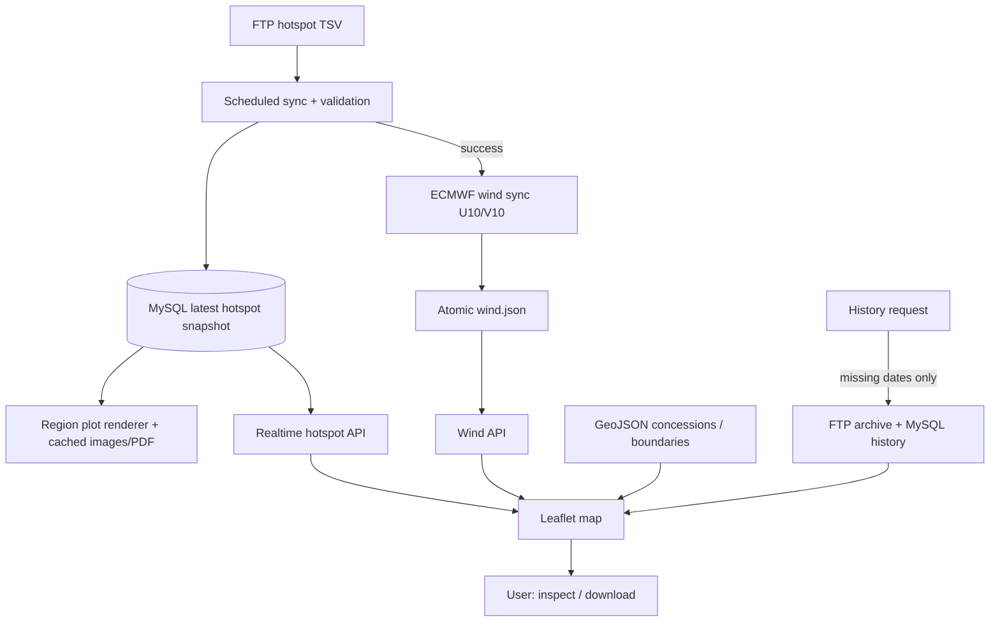

# Implementation Plan — How It Works | Koordinat Hotspot

**Tujuan:** section *How It Works* untuk case study modul peta hotspot Kalimantan Timur dalam website portofolio existing. Gunakan visual **vertical scroll narrative** dengan progres dari atas ke bawah mengikuti pergerakan scroll; tampilkan cabang angin dan histori secara jelas.

## Editorial concept: From Data Sync to Interactive Map
- Desktop: sisi kiri narasi 7 tahap yang memiliki ruang baca cukup; sisi kanan **sticky schematic** peta/alur data yang berubah berdasarkan active step.
- Garis vertikal tipis menyambungkan indeks tahap, terisi secara kontinu berdasarkan progres relatif dalam area section (bukan timer, bukan auto-advance).
- Tahap aktif ditunjukkan oleh perbedaan kontras dan tipografi; tahap lalu tidak hilang. Animasi dibatasi opacity/transform 8–16px dan trace jalur SVG ringan, mengikuti easing/tokens project.
- Mobile: alur satu kolom; schematic menjadi ringkasan inline atau panel statis di antara tahap, bukan sticky yang memakan viewport.
- Hindari ilustrasi gerak partikel angin berat: animasi garis/vektor sederhana cukup untuk menjelaskan arsitektur. Bila memakai screenshot asli, jangan merekonstruksi data kejadian seolah realtime.

## Narasi dan copy setiap tahap
| No | Label ringkas | Headline/penjelasan untuk pengunjung | Visual diaktifkan |
|---|---|---|---|
| 01 | Scheduled ingestion | Cron mengambil file hotspot TSV dari sumber FTP BMKG pada interval operasional; jika belum tersedia, mencoba tanggal sebelumnya dengan batas tertentu. | Sumber → ingestion job |
| 02 | Parse & validate | Parser memeriksa struktur TSV, koordinat, wilayah `KALIMANTAN TIMUR`, tanggal, dan nilai confidence; titik tak valid dilewati. | Data raw → titik terverifikasi |
| 03 | Persist snapshot | Data terbaru di-upsert ke tabel MySQL `hotspot_data` (`id=1`). Sync gagal tidak menghapus snapshot terakhir. | Ingestion → MySQL snapshot |
| 04 | Prepare map products | Worker Python menghasilkan gambar/peta wilayah dan PDF yang dicache berdasarkan hash; pointer manifest terbaru diperbarui secara atomik. | Snapshot → region-plots cache |
| 05 | Align model wind | Setelah sync hotspot sukses, job terpisah mengambil ECMWF IFS U10/V10, menyesuaikan waktu valid dengan interpolasi/nearest bila perlu, lalu menulis `wind.json` secara atomik. Kegagalan angin tidak menggagalkan hotspot. | Cabang ECMWF → wind.json |
| 06 | Serve interactive map | Browser mengambil snapshot via `GET /api/koordinat-hotspot`, overlay GeoJSON, dan angin via API terpisah. Leaflet menampilkan marker, layer kontekstual, popup WITA; WebGL menggerakkan partikel angin. | API → map viewport |
| 07 | Explore & export | Pengguna dapat memeriksa histori maks. 31 hari, mengaktifkan layer konsesi/gambut, melihat gallery peta wilayah dan ekspor PDF. Mode histori menonaktifkan angin karena data multi-hari tak sejajar satu waktu angin. | User controls → history/PDF |

## Percabangan yang harus jelas

Diagram ini hanya spesifikasi relasi; render final pakai komponen project bukan embed Mermaid mentah kecuali memang gaya project begitu.

## Scroll interaction spec
- Tentukan active step berdasarkan titik pembacaan viewport (sekitar 40–50% tinggi viewport) memakai IntersectionObserver; gunakan scroll progress untuk fill track bila utilitas library existing tersedia.
- Saat bergerak ke bawah: step dan koneksi terkait aktif, tidak perlu menampilkan 7 animation sequences yang berat. Saat scroll ke atas: progres dan node kembali mengikuti posisi secara alami.
- Sticky panel dengan `position: sticky` hanya dalam batas section; jangan memaksa scroll-jacking, pin entire page, atau mengunci scroll normal.
- Beri alternatif interaksi klik nomor tahap (jika project sudah memakai navigasi step), menggeser fokus dengan `scrollIntoView` dan menjaga accessibility.
- Label rute realtime vs histori terlihat jelas dan tidak menyamakan snapshot dengan data live sensor.

## Edge cases nyata
- Jika FTP gagal, UI dapat terus menampilkan snapshot terakhir dan timestampnya.
- Jika angin gagal, marker hotspot tetap ada; jangan gantikan dengan animasi palsu.
- Histori dapat lebih lambat pada tanggal yang belum dicache; jangan klaim offline instant archive.
- Konversi timestamp WIB pada file ke WITA ditangani saat ditampilkan; visual boleh memberi label `WITA` tanpa menjelaskan seluruh detail parser.

## Instruksi wajib sebelum coding
1. Audit repository **portofolio**, bukan menganggap repository sumber produk BMKG tersedia. Cari route detail proyek yang relevan dengan `koordinat-hotspot` menggunakan file-based router nyata. Jangan berasumsi URL-nya `/project/koordinat-hotspot` jika repository menggunakan slug lain. Bila belum ada, ikuti konvensi `project(s)/[slug]` yang ditemukan; jangan mengubah route global.
2. Pelajari theme existing: font, design tokens, CSS variables, spacing, container width, border/radius, light/dark, responsive breakpoints, komponen shared, library animasi, section How It Works/Key Features/Architecture/Tech Stack dari proyek lain. **Reuse**, bukan menciptakan sistem desain baru.
3. Periksa dependensi dan pola scroll animation existing. Gunakan IntersectionObserver + CSS transforms dan requestAnimationFrame hanya bila perlu; jika ada Motion/GSAP gunakan yang sudah ada sesuai pola repository. Jangan instal library berat hanya untuk satu section.
4. Audit aset screenshot aktual produk (jika ada). Gunakan gambar aktual yang relevan; jika tidak tersedia gunakan UI schematic berbasis HTML/SVG sederhana dengan label `Illustrative flow`, **bukan mockup dashboard fiktif** atau stock photography.
5. Hindari AI slop: tidak ada grid 6 kartu identik, glow neon, glassmorphism default, blur masif, floating gradient blobs, angka KPI karangan, ilustrasi 3D berlebihan, motion bouncing, atau penumpukan badges.
6. Section harus sepenuhnya aksesibel: heading hierarchy, kontras, fokus keyboard, klik/tap, `prefers-reduced-motion`, navigasi dan deskripsi yang tetap terbaca saat JS mati.
7. Semua layout untuk mobile-first; tidak ada horizontal overflow. Animasi gunakan transform/opacity dan hindari re-render semua node saat scroll. Lazy-load gambar dan bersihkan observer/listener.
8. Integrasikan di halaman detail **yang sudah ada**, bukan membuat aplikasi atau landing page baru. Jangan merombak header, footer, root layout, global typography atau sections lain.
9. Konten merupakan **case study developer**, bukan deck presentasi, bukan dokumentasi admin, dan bukan marketing yang mengklaim dampak terukur tanpa data.
10. Setelah selesai: jalankan pemeriksaan yang tersedia (`lint`, `typecheck`, `build` bila masuk akal), periksa reduced-motion/mobile, laporkan file yang berubah dan setiap asumsi yang belum terverifikasi.

## Batas fakta produk (jangan salah klaim)
- `/koordinat-hotspot` adalah modul dalam web BMKG Kaltim, **bukan** modul `/geohotspot` yang memakai deteksi termal B07. Jangan menggabungkan keduanya.
- Halaman realtime membaca snapshot `hotspot_data` melalui API; **tidak** mengunduh FTP langsung pada setiap kunjungan.
- Angin dari ECMWF IFS U10/V10 yang disiapkan cron dan dirender lewat WebGL sendiri; bukan prediksi kebakaran, bukan estimasi arah sebaran api atau asap, dan bukan data angin observasi persis saat hotspot muncul.
- Histori bisa memicu unduhan FTP untuk tanggal belum tercache (maksimum 10 tanggal per request), bukan sepenuhnya precomputed.
- Polygon konsesi adalah referensi spasial, bukan kepastian hak/legalitas atau bukti hotspot penyebab kebakaran.
- UI refresh realtime setiap 5 menit; cron contoh berjalan menit 05 dan 35, bukan setiap detik.
- Jangan tampilkan alamat host privat, password, username, token, IP infrastruktur, nilai rahasia, ataupun endpoint administrasi sensitif pada portofolio.

## Deliverable & acceptance criteria
- Section terintegrasi dalam halaman detail produk sesuai pola existing; konten data dipisah dari markup bila cocok dengan project.
- Scroll up/down berfungsi deterministik; keyboard/tap dan reduced-motion tetap dapat membaca informasi yang setara.
- Visual mengikuti theme asli, bukan warna paksa dari produk sumber.
- Setiap klaim dapat ditelusuri ke `DOKUMENTASI-KOORDINAT-HOTSPOT.md`; fitur yang tak terbukti tidak ditampilkan sebagai fitur jadi.
- Tidak ada perubahan di luar scope dan tidak ada dependency baru tanpa alasan teknis kuat.
