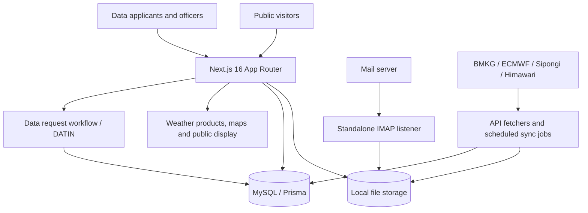

# PLAN — System Architecture | BMKG Kalimantan Timur Web Portal

> Implementation brief untuk Claude Code. Bangun **section System Architecture** dalam halaman detail project Web BMKG Kalimantan Timur. Temukan route existing di repo portofolio.

## Konsep — Interactive Three-Pillar Architecture

Bangun diagram node–edge yang dapat dieksplorasi, **bukan chart server generik**. Tampilkan tiga pilar yang berkaitan tetapi memiliki jalur data berbeda: **Public Portal**, **IMAP Product Intake**, **Data Request Service**. Tambahkan jalur scheduled observation/geospatial sebagai sumber terkait, bukan memaksanya melewati IMAP. Jadikan informasi mudah dipahami oleh rekruter teknis tanpa membaca endpoint atau kode internal.

## Topologi yang harus akurat

Diagram di atas **ringkasan konseptual**, bukan klaim bahwa semua data eksternal lewat jalur identik. Dalam versi final, bedakan: API read langsung/proxy, cron ke filesystem atau DB, serta unggah produk secara eksplisit. Jangan gambarkan listener IMAP menulis database; pada jalur IMAP ia menulis file + log.

## Empat fokus eksplorasi (tabs atau scroll spotlight)

### A — Public Delivery

Next.js App Router/React, halaman publik, API routes, data API resmi BMKG, media file, produk radar, nowcast, peta/overlay. Jelaskan mana remote API dan mana media lokal. Untuk preview, gunakan node Browser → Next.js → sumber/file.

### B — Product Ingestion

IMAP `imap` + `mailparser` + `sharp` bekerja sebagai proses terpisah; subject matching → latest UID → image processing → `public/produk`; frontend mengakses file melalui API. Jalur unggah MeteoFactory **berbeda**, ke `public/uploads/produk`.

### C — Geospatial & Observational Jobs

Cron radar, Sipongi/hotspot, ECMWF wind preprocessing (`GRIB2` dan ecCodes → wind JSON), worker Python GeoHotspot Himawari ke file dan MySQL. Jangan menampilkan endpoint host internal, credentials, atau jalur absolut host produksi dalam portofolio.

### D — Data Service and Access Control

Permohonan dari pengguna, NextAuth instance pelayanan, Next.js handlers, Prisma/MySQL, petugas DATIN, tahap review/billing manual/file delivery/SKM. Jelaskan pemisahan sesi umum, pelayanan, dan datacenter. Jangan mengesankan pembayaran otomatis via SIMPONI.

## Interaction specification

- Diagram dibuat dengan SVG/CSS/HTML yang mudah diakses; jangan memperkenalkan canvas/3D/diagram runtime berat tanpa kebutuhan.
- Node dapat difokuskan keyboard dan diklik/tap. Panel di bawah/samping menjelaskan tanggung jawab node, input/output, dan koneksinya secara sederhana.
- Ketika memilih fokus A–D, sorot node/edge terkait dan redupkan sisanya secukupnya; teks tetap dapat dibaca. Durasi transisi singkat dan konsisten dengan theme.
- Konektor SVG mengikuti geometry layout melalui viewBox responsif; jangan menggambar garis dengan koordinat hardcode yang patah di breakpoint.
- Mobile fallback: empat kelompok arsitektur dalam accordion/stack yang dapat diaktifkan, tanpa scroll horizontal.
- Scroll spotlight opsional bila referensi arsitektur project sebelumnya memang menggunakannya; jangan mengulang timeline identik.
- Semua node adalah informasi editorial statis, tidak mengambil telemetry produksi.

## Security-sensitive content

Dokumentasi sumber mengidentifikasi kelemahan pada beberapa upload/auth/TLS. **Jangan mempromosikan security maturity yang tidak terbukti.** Jangan tulis hardcoded API key, konfigurasi lingkungan, private IP, token, identitas pemohon, atau path server produksi dalam komponen publik. Bila membuat catatan Engineering Considerations, cukup sebut *authentication and endpoint hardening remain ongoing considerations* tanpa mengungkap cara mengeksploitasi sistem.

## Acceptance criteria

- [ ] IMAP/file output vs MySQL data-request dibedakan secara tegas.
- [ ] Jalur upload langsung vs IMAP terpisah.
- [ ] Cron/worker dan API luar tidak disatukan secara keliru.
- [ ] Node/edge clickable dan accessible, responsif tanpa horizontal overflow.
- [ ] Animasi ringan dan senada dengan halaman portofolio.

## Instruksi wajib sebelum implementasi

1. Audit repository **portofolio yang sedang aktif**, bukan repository BMKG, untuk menemukan route detail project yang benar. Jangan membuat route tebakan; ikuti konvensi existing `/project/...` atau path yang sudah terdaftar. Jangan mengganti slug atau merusak halaman project lain.
2. Temukan implementasi section yang sudah dibuat untuk Auto-Sosmed, ATMOS–WRF, atau WhatsApp AI Agent sebagai **referensi perilaku interaksi**, bukan template visual yang disalin mentah. Identifikasi tokens CSS, tema gelap/terang, tipografi, breakpoint, motion utility, sistem icon, spacing, komponen, serta cara section disusun.
3. Pakai komponen, styles, dan library motion existing. Jangan memasang dependency baru kecuali benar-benar diperlukan dan ada alasan eksplisit. Jangan memodifikasi global theme untuk mengakomodasi satu section.
4. Semua screenshot berasal dari asset nyata project yang tersedia. Jika asset belum ada, gunakan placeholder tipografis yang tertata atau komponen CSS sederhana dengan label yang jelas; **jangan mengarang screenshot dashboard asli** atau mengunduh ilustrasi stock.
5. Isi berdasarkan `DOKUMENTASI-WEB-KALTIM-BMKG.md` sebagai sumber fakta. Ini adalah halaman **portofolio**, bukan dokumentasi administrasi publik atau presentasi. Jelaskan sistem dengan bahasa profesional yang ringkas, bukan copy panjang dari file.
6. Hindari AI slop: jangan default ke gradient ungu-biru, glow, glass cards bertumpuk, border bercahaya, floating emoji, animasi bounce, efek parallax berlebihan, atau six-card grid generik. Pilih tipografi, alignment, hirarki editorial, garis tipis, dan ruang kosong yang mengikuti identitas project.
7. Aksesibilitas: semantic section/headings, keyboard support, focus visible, alt text, `prefers-reduced-motion`, state tekstual tidak hanya warna, dan mobile touch-friendly. Animasi tidak boleh menghalangi akses konten.
8. Performa: animasi hanya transform/opacity bila memungkinkan, gunakan IntersectionObserver/scroll hooks yang sudah ada, passive scroll listeners bila perlu; hindari layout thrashing, interval polling dekoratif, canvas berat, request API asli, dan rendering ulang seluruh halaman per frame. Cleanup event listener/observer.
9. Pastikan semua visualisasi **demonstrasi konseptual statis** untuk portofolio, bukan API live yang mengakses mailbox, data pemohon, internal host, atau credentials. Jangan mengungkap kredensial, alamat jaringan privat, file sensitif, atau data pengguna asli.
10. Setelah implementasi jalankan lint/typecheck/build yang relevan, cek mobile, layar besar, reduced motion, scroll maju/mundur, keyboard, hydration dan tidak ada layout shift. Laporkan file yang diubah dan validasi yang dilakukan.

## Gaya penulisan dan hasil

Gunakan copy berbahasa Inggris yang konsisten dengan halaman detail project sebelumnya **jika memang itu bahasa project**; bila portofolio menggunakan Bahasa Indonesia, ikuti bahasa existing. Pertahankan istilah teknis asli. Judul, deskripsi, dan visual harus terbaca tanpa motion. Jangan menampilkan metrik dampak, latency, uptime, dan angka penghematan yang belum dibuktikan.
