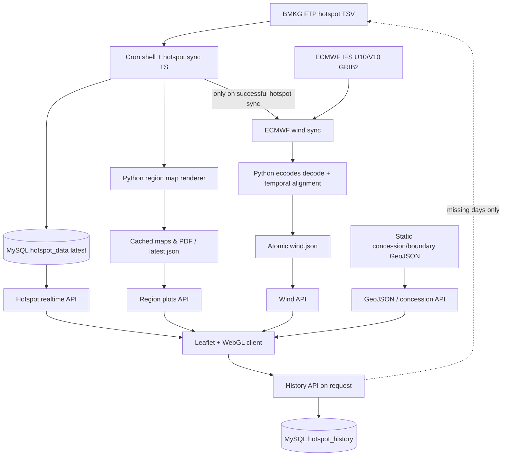

# Implementation Plan — System Architecture | Koordinat Hotspot

**Tujuan:** sebuah *interactive architecture explorer* pada halaman portofolio yang menunjukkan cara proses ingestion, data, API, dan rendering browser saling berhubungan. Bukan sekadar diagram alur pengguna.

## Architecture facts
Ada 4 domain konseptual:
1. **External data** — FTP BMKG untuk TSV hotspot; ECMWF Open Data untuk GRIB2 U10/V10; static GeoJSON untuk batas dan konsesi.
2. **Scheduled processing** — shell cron wrapper, `sync-hotspot.ts`, region map renderer Python, `sync-ecmwf-wind.ts` plus eccodes Python decode.
3. **Persistence & read APIs** — MySQL `hotspot_data` dan `hotspot_history`, `public/generated/.../region-plots`, `data/ecmwf/current/wind.json`, `geojson/*.geojson`; API yang melayani masing-masing.
4. **Client visualization** — Next.js route, Leaflet map, imperative Leaflet panes, custom GPU WebGL wind layer, history/layer controls, jsPDF.

## Diagram canonical (semantik, bukan petunjuk desain)

## Important distinctions (harus masuk detail panel nodes)
- **Realtime DB:** `hotspot_data` satu row `id=1`, ditimpa cron; bukan event stream semua titik historis.
- **History DB:** `hotspot_history` per source date; missing dates bisa didapatkan dari FTP atas permintaan pengguna (maks 10 hari/request).
- **File storage:** region-plots punya cache SHA-256-based dan `latest.json` atomic; wind JSON juga atomic. Tidak ada Kafka/Redis/queue daemon.
- **Cron orchestration:** hotspot diproses dahulu; wind job hanya dicoba setelah hotspot sukses, tetapi kegagalan wind tidak membuat hasil hotspot dianggap gagal.
- **Web API:** endpoint realtime tidak memanggil FTP. Wind API hanya membaca JSON dan memvalidasi ukuran grid.
- **Leaflet + WebGL:** Leaflet menangani marker/GeoJSON/panes; partikel U/V digambar canvas GPU lewat engine khusus, bukan react-leaflet atau plugin wind pihak ketiga.
- **Database access khusus modul:** `mysql2` langsung ke DB `bmkg_bpp_db`, **bukan Prisma**, meskipun app utama mungkin punya Prisma.
- **Static context:** konsesi tidak diperbarui otomatis dari GIS eksternal saat halaman dibuka.

## Interaction design
- Desktop: diagram kiri (SVG/HTML simple nodes), panel detail atau narrative kanan; scroll menyorot layer secara bertahap (Sources → Processing → Persistence/API → Client).
- Node pada diagram bisa diklik atau difokuskan dengan keyboard, memunculkan keterkaitan masuk/keluar dan penjelasan ringkas. Kabel highlight mengikuti active node; hindari efek aliran partikel terus-menerus.
- Gunakan empat lapis label yang terlihat; layout koheren dengan diagram arsitektur case study sebelumnya, tetapi komposisi disesuaikan kompleksitas hotspot.
- Mobile: tampilkan grouped stack berdasarkan layer dengan koneksi pendek, bukan mengecilkan seluruh diagram desktop sampai tak terbaca.
- Gunakan node types dan edge data statis yang tervalidasi; jangan fetch ke API produksi sekadar untuk menggambar section portofolio.
- Gunakan SVG path pendek / CSS variables sesuai theme; animasi node/cables ditahan saat `prefers-reduced-motion`.

## Security/privacy note untuk portofolio
- Dokumentasi sumber mengindikasikan pekerjaan keamanan berupa kredensial fallback tertulis di code, serta API publik. **Jangan menampilkan secret** atau menarasikan seolah proses sudah sepenuhnya hardened.
- Boleh jelaskan batas engineering secara jujur di tooltip ‘Current constraints’ jika case study menyediakan section tersebut.

## Instruksi wajib sebelum coding
1. Audit repository **portofolio**, bukan menganggap repository sumber produk BMKG tersedia. Cari route detail proyek yang relevan dengan `koordinat-hotspot` menggunakan file-based router nyata. Jangan berasumsi URL-nya `/project/koordinat-hotspot` jika repository menggunakan slug lain. Bila belum ada, ikuti konvensi `project(s)/[slug]` yang ditemukan; jangan mengubah route global.
2. Pelajari theme existing: font, design tokens, CSS variables, spacing, container width, border/radius, light/dark, responsive breakpoints, komponen shared, library animasi, section How It Works/Key Features/Architecture/Tech Stack dari proyek lain. **Reuse**, bukan menciptakan sistem desain baru.
3. Periksa dependensi dan pola scroll animation existing. Gunakan IntersectionObserver + CSS transforms dan requestAnimationFrame hanya bila perlu; jika ada Motion/GSAP gunakan yang sudah ada sesuai pola repository. Jangan instal library berat hanya untuk satu section.
4. Audit aset screenshot aktual produk (jika ada). Gunakan gambar aktual yang relevan; jika tidak tersedia gunakan UI schematic berbasis HTML/SVG sederhana dengan label `Illustrative flow`, **bukan mockup dashboard fiktif** atau stock photography.
5. Hindari AI slop: tidak ada grid 6 kartu identik, glow neon, glassmorphism default, blur masif, floating gradient blobs, angka KPI karangan, ilustrasi 3D berlebihan, motion bouncing, atau penumpukan badges.
6. Section harus sepenuhnya aksesibel: heading hierarchy, kontras, fokus keyboard, klik/tap, `prefers-reduced-motion`, navigasi dan deskripsi yang tetap terbaca saat JS mati.
7. Semua layout untuk mobile-first; tidak ada horizontal overflow. Animasi gunakan transform/opacity dan hindari re-render semua node saat scroll. Lazy-load gambar dan bersihkan observer/listener.
8. Integrasikan di halaman detail **yang sudah ada**, bukan membuat aplikasi atau landing page baru. Jangan merombak header, footer, root layout, global typography atau sections lain.
9. Konten merupakan **case study developer**, bukan deck presentasi, bukan dokumentasi admin, dan bukan marketing yang mengklaim dampak terukur tanpa data.
10. Setelah selesai: jalankan pemeriksaan yang tersedia (`lint`, `typecheck`, `build` bila masuk akal), periksa reduced-motion/mobile, laporkan file yang berubah dan setiap asumsi yang belum terverifikasi.

## Batas fakta produk (jangan salah klaim)
- `/koordinat-hotspot` adalah modul dalam web BMKG Kaltim, **bukan** modul `/geohotspot` yang memakai deteksi termal B07. Jangan menggabungkan keduanya.
- Halaman realtime membaca snapshot `hotspot_data` melalui API; **tidak** mengunduh FTP langsung pada setiap kunjungan.
- Angin dari ECMWF IFS U10/V10 yang disiapkan cron dan dirender lewat WebGL sendiri; bukan prediksi kebakaran, bukan estimasi arah sebaran api atau asap, dan bukan data angin observasi persis saat hotspot muncul.
- Histori bisa memicu unduhan FTP untuk tanggal belum tercache (maksimum 10 tanggal per request), bukan sepenuhnya precomputed.
- Polygon konsesi adalah referensi spasial, bukan kepastian hak/legalitas atau bukti hotspot penyebab kebakaran.
- UI refresh realtime setiap 5 menit; cron contoh berjalan menit 05 dan 35, bukan setiap detik.
- Jangan tampilkan alamat host privat, password, username, token, IP infrastruktur, nilai rahasia, ataupun endpoint administrasi sensitif pada portofolio.

## Deliverable & acceptance criteria
- Section terintegrasi dalam halaman detail produk sesuai pola existing; konten data dipisah dari markup bila cocok dengan project.
- Scroll up/down berfungsi deterministik; keyboard/tap dan reduced-motion tetap dapat membaca informasi yang setara.
- Visual mengikuti theme asli, bukan warna paksa dari produk sumber.
- Setiap klaim dapat ditelusuri ke `DOKUMENTASI-KOORDINAT-HOTSPOT.md`; fitur yang tak terbukti tidak ditampilkan sebagai fitur jadi.
- Tidak ada perubahan di luar scope dan tidak ada dependency baru tanpa alasan teknis kuat.
